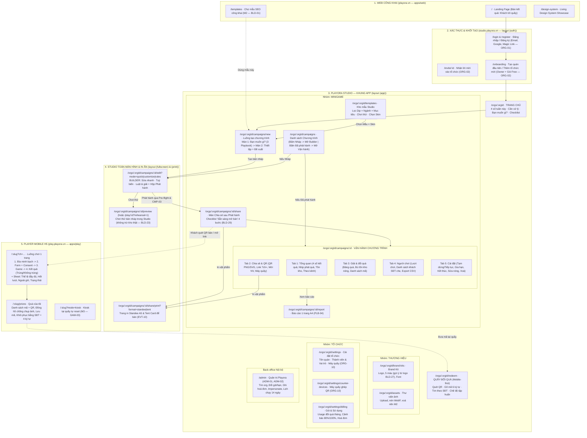

# Sơ đồ trang web & Cấu trúc UI từng trang chuẩn SaaS

Cập nhật: 01/11/2026 · Phiên bản: **2.0 (Đối chiếu chuẩn xác PRD v4.3 & Nghiên cứu đối thủ)** · Owner: PO / Design Lead · Liên quan: [strategy.md](../strategy.md), [prd.md](../prd.md), [decisions.md](../decisions.md), [studio-ux.md](./studio-ux.md), [builder.md](./builder.md), [playbooks.md](./playbooks.md), [prizes-redemption.md](./prizes-redemption.md), [participation.md](./participation.md), [design-system.md](../../engineering/design-system.md), [builder-components.md](../../engineering/builder-components.md), [guandayun-teardown.md](../../research/guandayun-teardown.md), [builder-research.md](../../research/builder-research.md)

> **Tuyên ngôn kiến trúc giao diện Playora:**
> 1. **Bán kết quả kinh doanh, không bán công cụ vẽ game** ([D-15](../decisions.md), [D-16](../decisions.md)): Mọi màn hình báo cáo đều đặt **Khách tới quầy · Khách quay lại · Chi phí quà đã đổi · Chi phí/khách** lên trước số lượt chơi.
> 2. **Một chương trình — Hai chế độ tự suy** ([studio-ux §2](./studio-ux.md#2-mô-hình-một-chương-trình-hai-chế-độ)): Bấm vào chương trình đang là `Nháp` luôn mở thẳng **Builder toàn màn hình** (`/edit`); bấm vào chương trình đã phát hành (`Đã lên lịch`, `Đang chạy`, `Tạm dừng`, `Đã kết thúc`) luôn mở thẳng **Màn hình Vận hành** (`/campaigns/:id`). Không bao giờ trả người dùng về danh sách sau một bước hành động.
> 3. **Studio desktop-first, Game & Quầy đổi quà mobile-first** ([D-12](../decisions.md)): Ngoại lệ thứ hai trên Studio là thao tác khẩn trên điện thoại tại trang Vận hành (`EVT-15`: tạm dừng/tiếp tục, bù tồn kho, xem 4 số chính).
> 4. **Không điểm chết tại quầy thu ngân (Zero-Dead-End Counter):** Quầy không bao giờ từ chối mã đã phát vì chạm hạn mức gói ([D-23](../decisions.md)), ghép máy quầy bằng QR không cần email ([D-24](../decisions.md)), cứu mã khi khách mất/đổi trình duyệt bằng tra cứu SĐT tại quầy (`PRZ-15`) hoặc khôi phục bằng SĐT + 4 ký tự cuối (`PRZ-16`, [D-25](../decisions.md)).

---

## 1. Phân tích đối chiếu PRD v4.3 & Học hỏi từ đối thủ

### 1.1. Các nguyên tắc bất khả xâm phạm từ PRD v4.3

| Hạng mục | Quy định chuẩn trong PRD v4.3 | Lý do / Quyết định gốc |
|---|---|---|
| **Đối tượng chính** | UI gọi là **Chương trình** (*Campaign*); M1 mỗi chương trình có **đúng 1 game** (ẩn danh sách nhiều game của sự kiện cũ) | [studio-ux §2](./studio-ux.md), [ADR-015](../../adr/015-campaign-persistence.md) |
| **Vòng đời suy ra** | Hệ thống tự suy từ trạng thái lưu + lịch + cờ tạm dừng (`Nháp` → `Đã lên lịch` → `Đang chạy` ⇄ `Tạm dừng` → `Đã kết thúc`). Không có ô dropdown chọn trạng thái bằng tay | `EVT-01`, `lib/phase.ts` |
| **North Star & Chi phí** | `Khách tới quầy` = số `awards` có `status = redeemed`. `Chi phí quà` chỉ cộng giá vốn của **quà đã thực đổi tại quầy** (quà đã phát chưa đổi hiện dòng phụ riêng). **Không** hiện "doanh thu tăng thêm" ở M1 | `PLB-03`, [playbooks §3.2](./playbooks.md#32-định-nghĩa-chỉ-số) |
| **Điểm chặn hạn mức gói** | Chặn ở **lúc phát giải** khi `(mã còn hiệu lực chưa đổi + mã đã đổi trong tháng) >= 110% hạn mức`. Lượt chơi vẫn chạy (trả kết quả không trúng: *"Hôm nay quà đã hết"*). **Quầy luôn đổi được mã đã phát** | `BIL-02`, [D-23](../decisions.md) |
| **Loại giải ở M1** | Chỉ có 1 loại giải duy nhất: **Quà đổi tại quầy (`physical`)** — hiện vật, dịch vụ, voucher giảm giá tại quán. "Không trúng" là `outcome: lose`, không phải một dòng giải thưởng | `PRZ-01`, `GAM-01` |
| **Ngoài phạm vi** | Không quiz/poll, không game LED/sân khấu, không lì xì tiền mặt, không cơ chế ép rủ bạn bè (gom like/mặc cả), **không ticker người trúng giả**, không định trước người trúng | [strategy §7](../strategy.md#7-nguyên-tắc-sản-phẩm), `D-01`, `D-02`, `GB-D10` |

### 1.2. Ý tưởng đắt giá chọn lọc từ đối thủ (Competitive UX Patterns)

Dựa trên khảo sát [guandayun-teardown.md](../../research/guandayun-teardown.md) và [builder-research.md](../../research/builder-research.md), thiết kế UI của Playora kế thừa có chọn lọc các pattern tốt nhất ngành:

| Nguồn đối thủ | Pattern học hỏi | Cách đưa vào cấu trúc UI Playora | ID PRD |
|---|---|---|---|
| **凡科互动 (Faisco / Guandayun)** | Chọn `派奖方式` (Cách phát giải) làm cổng quyết định đầu tiên trước khi hiện form giải thưởng | Ở chế độ **Luật & giải**, Bước 1 bắt chọn 1 trong 3 thẻ: `Tỷ lệ trúng chung` (mặc định) · `Tỷ lệ riêng từng giải` · `Chắc chắn trúng 100%`. Chọn xong mới mở các cột tương ứng ở Bước 2 | `BLD-21`, `PRZ-05` |
| **凡科互动 (Faisco)** | QR chơi thử trên máy thật ngay cạnh Preview (`预览`), giới hạn 20 người ngoài tổ chức, không trừ kho/quota | Cạnh khung điện thoại trong Builder có nút **"Mở trên điện thoại"** bật popover QR của link nháp công khai để chủ quán quét thử trên Zalo thật | `BLD-23`, `BLD-26` |
| **凡科互动 (Faisco)** | Dải lịch lễ hội theo mùa (`节日日历`) trên đầu Chợ mẫu | Bản địa hoá thành **Dải chip Mùa vụ Việt Nam** trên trang Kho mẫu: `🧧 Tết`, `🌸 8/3`, `🏖️ Hè`, `🥮 Trung thu`, `💐 20/10`, `🎄 Noel`, `🎉 Khai trương`, `☕ Quanh năm` | `BLD-01`, `BLD-06` |
| **Easypromos & Drimify** | Instant-Win Pacing Scheduler & Smoothing (rải đều quà theo thời gian & giờ mở cửa) | Thẻ **"Nhịp phát quà"** trên tab Tổng quan: vẽ đường kế hoạch đứt nét so với đường thực tế, cảnh báo khi lệch > 20% và có nút **"Áp dụng tỷ lệ đề xuất"** 1 chạm | `PRZ-07`, `PRZ-22` |
| **Drimify & Qualifio** | Wizard luồng màn hình chuẩn bao quanh mọi cơ chế game (`Start → Form → Game → End`) | Cột trái Builder cố định 5 màn (`Bìa` → `Form` → `Game` → `Trúng` → `Không trúng`) + nút xem thử **Sheet thông báo hệ thống** (`Hết lượt`, `Ngoài giờ`, `Tạm dừng`) | `BLD-07`, `ADR-012` |
| **Playable & Canva** | Tương tác 2 chiều *Click-to-Focus Slot* giữa Canvas Preview và bảng Quick Edit | Ở chế độ **Sửa nhanh**, bấm vào Logo/Ảnh sản phẩm/Tiêu đề ngay trên màn hình điện thoại giữa sẽ tự cuộn và highlight thẻ `SlotCard` tương ứng ở cột phải | `BLD-19`, `GB-Q02` |
| **WOAY & Thực tế F&B VN** | Xử lý đứt gãy trình duyệt in-app Zalo → Safari và nhân viên ca thời vụ không có email | Bộ 3 tính năng cứu hộ: (1) Nút **Lưu mã vào Zalo/Ảnh** trên màn Trúng; (2) **Khôi phục ví quà** bằng SĐT + 4 ký tự cuối; (3) **Tìm mã theo SĐT** & **Ghép máy quầy bằng QR** | `PRZ-15`, `PRZ-16`, `ORG-10` |
| **Attio / Linear / BoardUI** | Floating Sidebar, Command Palette `⌘K`, Side-Drawer 612px, Single Primary Action | Khung `AppShell` chuẩn B2B SaaS hiện đại, xem nhanh chi tiết trên bảng qua ngăn trượt phải mà không mất bộ lọc | [design-system §3.4](../../engineering/design-system.md#34-luật-studio-theo-games-vt) |

---

## 2. Sơ đồ trang web tổng thể (Master Sitemap & Route Architecture)

### 2.1. Sơ đồ kiến trúc phân hệ và luồng chuyển trang

Toàn bộ URL trong Studio được quản lý tập trung qua [`routes.ts`](file:///Users/shin/Project/playora/apps/studio/src/features/builder-lab/lib/routes.ts). Mỗi màn hình kết thúc bằng việc đưa người dùng sang bước kế tiếp trong vòng giá trị.



---

### 2.2. Ma trận Route × Phân quyền (RBAC 7 Vai trò) & Giai đoạn

Theo `packages/auth/src/permissions.ts` và PRD §5.1 (`ORG-02`, `ORG-02a`, `ORG-10`, `ORG-12`):

| Route | `owner` | `admin` | `editor` | `operator` | `viewer` | `redeemer` / Máy quầy | `store_manager` (M2) |
|---|:---:|:---:|:---:|:---:|:---:|:---:|:---:|
| `/orgs/:orgId` (Trang chủ) | ✅ | ✅ | ✅ | ✅ | ✅ | ❌ *(vào thẳng `/redeem`)* | ✅ *(lọc theo quán)* |
| `/orgs/:orgId/campaigns` (Danh sách) | ✅ | ✅ | ✅ | ✅ *(chỉ xem)* | ✅ *(chỉ xem)* | ❌ | ✅ *(chỉ xem)* |
| `/orgs/:orgId/campaigns/new` (Tạo mới) | ✅ | ✅ | ✅ | ❌ | ❌ | ❌ | ❌ |
| `/orgs/:orgId/campaigns/:id/edit` (Builder) | ✅ | ✅ | ✅ | ❌ | ❌ | ❌ | ❌ |
| `/orgs/:orgId/campaigns/:id` (Vận hành) | ✅ | ✅ | ✅ | ✅ *(chỉ xem)* | ✅ *(chỉ xem)* | ❌ | ✅ *(bù kho quán mình)* |
| **Export CSV/XLSX** (`ANL-02`) | ✅ | ✅ | ❌ | ❌ | ❌ | ❌ | ❌ |
| `/orgs/:orgId/redeem` (Quầy đổi quà) | ✅ | ✅ | ✅ | ✅ | 👁️ *(chỉ tra cứu)* | ✅ *(Tra cứu + Đổi)* | ✅ |
| **Mở lại mã đổi nhầm** (`voucher.reopen`) | ✅ *(Duy nhất)* | ❌ | ❌ | ❌ | ❌ | ❌ | ❌ |
| `/orgs/:orgId/brand-kits` & `/assets` | ✅ | ✅ | ✅ | 👁️ *(chỉ xem)* | 👁️ *(chỉ xem)* | ❌ | ❌ |
| `/orgs/:orgId/settings` (Thành viên) | ✅ | ✅ | 👁️ | 👁️ | 👁️ | ❌ | ✅ *(nhân viên quán mình)* |
| `/orgs/:orgId/settings/counter-devices` | ✅ | ✅ | ❌ | ❌ | ❌ | ❌ | ✅ *(máy quầy quán mình)* |
| `/orgs/:orgId/settings/billing` | ✅ | ✅ | 👁️ | 👁️ | 👁️ | ❌ | ❌ |
| `/admin` (Back-office nội bộ) | 🔒 *Chỉ email trong `PLATFORM_ADMIN_EMAILS` (trả 404 với mọi tài khoản khác)* | | | | | | |

---

## 3. Cấu trúc Khung giao diện chuẩn SaaS (Studio App Shell)

Áp dụng cho toàn bộ route thuộc nhóm `(app)` (xem [`app-shell.tsx`](file:///Users/shin/Project/playora/apps/studio/src/components/app-shell.tsx) và [`design-system.md §3.4`](file:///Users/shin/Project/playora/docs/engineering/design-system.md#34-luật-studio-theo-games-vt)):

```
+----------------------------------------------------------------------------------------------------------+
| SIDEBAR NỔI (Floating Panel 250px / 60px)  | HEADER VÙNG LÀM VIỆC (h-12 / 48px)                          |
| rounded-3xl, border 0.5px, shadow-sidebar  | Breadcrumbs: Trà Sữa Mộc / Chương trình  [🔔 (2)] [➕ Tạo]  |
|--------------------------------------------+-------------------------------------------------------------|
| [🟢 Trà Sữa Mộc v]              [Thu gọn] |                                                             |
| [ 🔍 Tìm nhanh chương trình, trang... ⌘K ] |                                                             |
|                                            |                                                             |
| 🏠 Trang chủ             (Active Gradient) |                  VÙNG NỘI DUNG CHÍNH                        |
| 🎟️ Đổi quà                                 |                 (MAIN WORKSPACE AREA)                       |
|                                            |          Không dùng max-w-* làm hẹp khung bảng;             |
| ▾ MINIGAME                                 |          Dùng PageHeader + MetricGrid + TableCard           |
|   📅 Chương trình                          |                                                             |
|   🧱 Kho mẫu                               |                                                             |
|                                            |                                                             |
| ▾ THƯƠNG HIỆU                              |                                                             |
|   🎨 Brand kit                             |                                                             |
|   🖼️ Thư viện ảnh                          |                                                             |
|                                            |                                                             |
| ▾ TỔ CHỨC                                  |                                                             |
|   ⚙️ Cài đặt                               |                                                             |
|   💳 Gói & sử dụng                         |                                                             |
|--------------------------------------------|                                                             |
| [ 🚀 Bắt đầu nhanh: 2/5 bước hoàn tất    ] |                                                             |
| [ ☀️ Sáng | 🌙 Tối ]                       |                                                             |
| [ (H) Chị Hà · ha@trasuamoc.vn       [⋯] ] |                                                             |
+----------------------------------------------------------------------------------------------------------+
```

### Quy chuẩn Thành phần Khung (Shell Components):
1. **Nhóm điều hướng trên Sidebar (`NAV_GROUPS`):**
   - Nhóm đầu (`start`): **Trang chủ** (`RiHome5Line`) và **Đổi quà** (`RiTicketLine`) đứng độc lập ở trên cùng để truy cập 1 chạm.
   - 3 nhóm Accordion thu/mở bên dưới: **Minigame** (`Chương trình`, `Kho mẫu`) · **Thương hiệu** (`Brand kit`, `Thư viện ảnh`) · **Tổ chức** (`Cài đặt`, `Gói & sử dụng`; thêm `Máy quầy` khi bật `ORG-10`).
   - Nếu người dùng có vai trò `redeemer` (`isRedeemerOnly(role)`): ẩn toàn bộ nhóm dưới, chỉ hiện duy nhất mục **Đổi quà**.
   - Menu chuyển đổi tổ chức ở đỉnh Sidebar (`Dropdown`) liệt kê các tổ chức hiện có kèm mục **`+ Tạo tổ chức mới`** dẫn tới `/onboarding`.
2. **Hộp Tìm kiếm nhanh (`⌘K` Command Modal):**
   - Bấm ô tìm kiếm trên Sidebar hoặc nhấn `⌘K` / `Ctrl+K` mở hộp tìm kiếm tức thì: lọc danh sách chương trình (kèm `PhaseTag`) và các trang điều hướng trong Studio.
3. **Trung tâm thông báo (`NotificationCenter`) trên Header:**
   - Tự động tổng hợp các cảnh báo sự vụ từ dữ liệu chiến dịch: quà còn `< 20%`, chương trình đang `Tạm dừng`, sắp kết thúc trong `≤ 48 giờ`, hoặc có thay đổi trong bản nháp chưa phát hành lại (`hasUnpublishedChanges`).
4. **Thẻ tiến độ Khởi tạo 5 bước (`SidebarOnboarding` & `OnboardingLaunchpad`):**
   - Đồng bộ trạng thái giữa thẻ ở đáy Sidebar và khối **Onboarding Launchpad** trên đầu Trang chủ (`/orgs/:orgId`):
     (1) Thêm logo và màu của quán (`brand`) → (2) Tạo chương trình đầu tiên (`campaign`) → (3) Đặt quà, luật và phát hành (`publish`) → (4) In QR đặt ở quầy & đón lượt chơi đầu tiên (`share`) → (5) Mời đồng nghiệp hoặc nhân viên quầy (`team`). Có thể thu gọn hoặc ẩn đi khi đã xong.

---

## 4. Cấu trúc UI chi tiết từng trang (Page-by-Page Wireframe & Spec)

---

### 4.1. Nhóm Xác thực & Khởi tạo (`/login`, `/register`, `/invite/[id]`, `/onboarding`)

```
[ /login & /register · SPLIT-SCREEN AUTH (ORG-01) ]    [ /onboarding · KHỞI TẠO TỔ CHỨC 2 CỘT (ORG-02) ]
+------------------------+------------------------+    +------------------------+------------------------+
| [Logo Playora]         | [Minigame kéo khách]   |    | [Logo]  [<- Về Studio] | XEM TRƯỚC TRỰC TIẾP    |
| Đăng nhập Studio       | Biến lượt chơi trên ĐT |    | Khởi tạo không gian    | play.playora.vn/moc    |
|                        | thành khách tới quầy.  |    | Tạo tổ chức đầu tiên   |                        |
| Email:                 |                        |    |                        | +--------------------+ |
| [ ha@trasuamoc.vn    ] |   +----------------+   |    | Tên tổ chức:           | | [M] Trà Sữa Mộc    | |
| Mật khẩu:              |   | 9:41        🔋 |   |    | [ Trà Sữa Mộc        ] | | Vòng Quay Quán Mới | |
| [ ••••••••••••       ] |   | Trà Sữa Mộc    |   |    | Đường dẫn (Slug):      | | 🎁 Tặng 1 Topping  | |
|                        |   |  ( VÒNG QUAY ) |   |    | [ tra-sua-moc        ] | | Mã: MỘC-68A        | |
| [ Đăng nhập (Primary)] |   | [Quay thử ngay]|   |    |                        | +--------------------+ |
| ----- Hoặc -----       |   +----------------+   |    | Màu nhận diện gợi ý:   |                        |
| [ ✉️ Gửi link Email  ] |                        |    | (•)Teal ( )Đỏ ( )Cam   | Gói Khởi Tạo (Free):   |
| [ G  Tiếp với Google ] | [✅ ĐỔI ĐƯỢC · MỘC-88A]|    |                        | ✓ Nháp không giới hạn  |
| Chưa có TK? [Đăng ký]  | [👥 312 khách · 31% QL]|    | [ Tạo tổ chức ->     ] | ✓ 100 lượt đổi/tháng   |
+------------------------+------------------------+    +------------------------+------------------------+
```

- **Trang Nhận lời mời (`/invite/[id]`):** Thiết kế dạng thẻ **Vé mời tham gia tổ chức** trong cùng layout `(auth)`: hiển thị `Logo`, avatar tổ chức, người mời, `Chip` vai trò kèm câu giải thích quyền hạn tự nhiên (ví dụ: vai trò `redeemer` giải thích rõ *"Vào thẳng màn Quầy đổi quà trên điện thoại để quét QR và xác nhận trao quà"*). Khi chưa đăng nhập và chuyển sang `/login?next=/invite/[id]`, đầu form hiện banner ngữ cảnh nhắc đăng nhập hoặc tạo tài khoản để nhận lời mời.

---

### 4.2. Trang chủ Studio (`/orgs/[orgId]`)
*Tham chiếu code: [`campaign-home.tsx`](file:///Users/shin/Project/playora/apps/studio/src/features/builder-lab/components/studio/campaign-home.tsx) · PRD: `PLB-01`, `PLB-03`, `ANL-01`, `BIL-02`*

```
+----------------------------------------------------------------------------------------------------------+
| [BANNER HẠN MỨC GÓI - Chỉ hiện khi usage >= 80% (BIL-02)]                                                |
| ⚠️ Bạn đã dùng 88/100 lượt đổi quà trong tháng này (88%). [ Xem Gói & sử dụng -> ]                       |
+----------------------------------------------------------------------------------------------------------+
| PageHeader: Xin chào, Trà Sữa Mộc                        [ Đổi quà tại quầy ]  [ + Tạo chương trình mới ]|
+----------------------------------------------------------------------------------------------------------+
| 1. KẾT QUẢ TUẦN NÀY (MetricGrid 4 cột — PLB-03)                                                          |
| +-----------------------+ +-----------------------+ +-----------------------+ +------------------------+ |
| | 👥 Khách tới quầy     | | 🔄 Khách quay lại     | | 💰 Chi phí quà đã đổi | | 🏷️ Chi phí / khách     | |
| | 312                   | | 97 (31%)              | | 1.400.000 đ           | | 4.487 đ                | |
| | 248 khách duy nhất    | | Đổi quà >= 2 ngày khác| | Ngân sách: 2.000.000đ | | Trên mỗi lượt tới quầy | |
| +-----------------------+ +-----------------------+ +-----------------------+ +------------------------+ |
+----------------------------------------------------------------------------------------------------------+
| 2. CẦN XỬ LÝ NGAY (Action Required — ANL-01, chỉ hiện khi có mục cần can thiệp)                          |
| +------------------------------------------------------------------------------------------------------+ |
| | 🔴 [Vòng quay Tết] Quà "Size Up Miễn Phí" chỉ còn 14% (14/100)              [ Mở Giải & đổi quà -> ] | |
| | 🟡 [Vòng quay Tết] Nhịp phát quà nhanh hơn 35% so với dự kiến (PRZ-22)      [ Xem đề xuất chỉnh -> ] | |
| | 🔵 [Cào thẻ Tháng 11] Có thay đổi trong bản nháp chưa phát hành lại         [ Mở Builder -> ]        | |
| +------------------------------------------------------------------------------------------------------+ |
+----------------------------------------------------------------------------------------------------------+
| 3. "BẠN MUỐN GÌ?" — TẠO NHANH THEO MỤC TIÊU (3 Playbook Cards — PLB-01)          [ Tự chọn từ Kho mẫu ] |
| +---------------------------------+ +---------------------------------+ +------------------------------+ |
| | 🧧 Tết: Kéo khách về quán       | | 🔁 Khách quay lại lần 2         | | 📉 Lấp ngày vắng (T2 - T4)   | |
| | Vòng quay · Skin Tết · Rải đều  | | Cào thẻ · Đổi lần 1 mới mở lần 2| | Mở hộp · Chỉ mở ngày vắng    | |
| | Đo: Lượt đổi quà / ngày         | | Đo: % khách quay lại trong 14d  | | Đo: Lượt đổi so với ngày thường|
| | [ Dùng kịch bản này -> ]        | | [ Dùng kịch bản này -> ]        | | [ Dùng kịch bản này -> ]     | |
| +---------------------------------+ +---------------------------------+ +------------------------------+ |
+----------------------------------------------------------------------------------------------------------+
| 4. CHƯƠNG TRÌNH GẦN ĐÂY (TableCard tóm tắt)                                      [ Xem tất cả (6) -> ]  |
| Tên chương trình         | Mục tiêu         | Trạng thái    | Lượt hôm nay | Quà còn lại  | Thao tác     |
| 🎡 Vòng quay Tết 2027    | Tết kéo khách    | 🟢 Đang chạy  | 64 lượt      | 312 / 400    | [Vận hành ->]|
| 🃏 Cào thẻ Khách Quen    | Khách quay lại   | ⚪ Bản nháp   | --           | 150 / 150    | [Soạn tiếp->]|
+----------------------------------------------------------------------------------------------------------+
```

---

### 4.3. Danh sách Chương trình (`/orgs/[orgId]/campaigns`)
*Tham chiếu code: [`campaign-list.tsx`](file:///Users/shin/Project/playora/apps/studio/src/features/builder-lab/components/studio/campaign-list.tsx), [`design-system.md §3.4`](file:///Users/shin/Project/playora/docs/engineering/design-system.md#34-luật-studio-theo-games-vt) · PRD: `EVT-01`, `BLD-15`*

```
+----------------------------------------------------------------------------------------------------------+
| PageHeader: Chương trình                                                         [ + Tạo chương trình ]  |
+----------------------------------------------------------------------------------------------------------+
| Thanh công cụ bảng (h-12):                                                                               |
| Trái: [ Bộ lọc v ] [Tất cả (6)] [🟢 Đang chạy (1)] [🔵 Đã lên lịch (1)] [🟡 Tạm dừng (1)] [⚪ Nháp (2)]  |
| Phải: [ 🔍 Tìm theo tên... ]  [ ⊞ Bảng | ⊟ Thẻ ]  [ ⇅ Sắp xếp ]                                         |
+----------------------------------------------------------------------------------------------------------+
| # | Chương trình (Ảnh + Tên) | Mục tiêu (Playbook) | Trạng thái   | Hôm nay | Quà còn lại | Hành động    |
|---+--------------------------+---------------------+--------------+---------+-------------+--------------|
| 1 | [🎡] Vòng quay Tết 2027  | [🧧 Tết kéo khách]  | 🟢 Đang chạy | 64 lượt | 312 / 400   | [Vận hành][⋯]|
| 2 | [🎁] Mở hộp Thứ Tư Vui   | [📉 Lấp ngày vắng]  | 🔵 Lên lịch  | --      | 200 / 200   | [Vận hành][⋯]|
| 3 | [🃏] Cào thẻ Khách Quen  | [🔁 Khách lần 2]    | ⚪ Nháp      | --      | 150 / 150   | [Mở Builder] |
+----------------------------------------------------------------------------------------------------------+
| TableFooter (h-11): Tổng số: 6 chương trình · Đang chạy: 1/3 (Gói Quán)                                  |
+----------------------------------------------------------------------------------------------------------+
```

- **Quy tắc điều hướng thông minh:**
  - Click vào dòng số 1 hoặc 2 (`Đang chạy` / `Đã lên lịch`) → mở `/orgs/{orgId}/campaigns/{id}` (Vận hành) hoặc mở **Ngăn chi tiết bên phải (`Drawer` 612px)** để xem nhanh 4 số kết quả + tồn kho mà không rời bảng.
  - Click vào dòng số 3 (`Nháp`) → mở thẳng `/orgs/{orgId}/campaigns/{id}/edit` (Builder toàn màn hình).
  - Menu `[⋯]`: Mở Builder, Xem báo cáo A4, Chia sẻ & QR, Nhân bản (`BLD-15` M2), Xoá (bị khoá/disable kèm tooltip giải thích khi trạng thái là `Đã lên lịch`, `Đang chạy` hoặc `Tạm dừng` theo `EVT-01`).

---

### 4.4. Luồng Tạo Chương trình (`/orgs/[orgId]/campaigns/new`) & Kho mẫu (`/templates`)
*Tham chiếu code: [`create-campaign-flow.tsx`](file:///Users/shin/Project/playora/apps/studio/src/features/builder-lab/components/home/create-campaign-flow.tsx), [`goal-picker.tsx`](file:///Users/shin/Project/playora/apps/studio/src/features/builder-lab/components/home/goal-picker.tsx), [`playbook-setup.tsx`](file:///Users/shin/Project/playora/apps/studio/src/features/builder-lab/components/home/playbook-setup.tsx), [`template-gallery.tsx`](file:///Users/shin/Project/playora/apps/studio/src/features/builder-lab/components/home/template-gallery.tsx) · PRD: `PLB-01`, `PLB-02`, `PLB-08`, `BLD-01`, `BLD-06`*

#### Màn 1: "Bạn muốn gì?" (`GoalPicker`)
- Hiển thị 3 thẻ Playbook lớn (Tết kéo khách · Khách quay lại lần 2 · Lấp ngày vắng), mỗi thẻ ghi rõ: **Mục tiêu kinh doanh**, **Mẫu + Skin mặc định**, **Luật mặc định**, và **Chỉ số đo lường chính**.
- Phía dưới có nút chuyển sang **"Tự chọn mẫu từ Kho mẫu"** (`TemplateGallery`).
- *Học từ 凡科:* Trong **Kho mẫu** (`/templates`), đầu trang có **Dải lọc Mùa vụ & Ngành** (`Tất cả`, `🧧 Tết`, `🎉 Khai trương`, `☕ Quanh năm` × `Đồ uống & F&B`, `Spa`, `Bán lẻ`), mỗi thẻ mẫu có nút **"Xem trước chơi thử"** (mở modal chơi thử ngay) và bộ chọn 3 chấm Skin (`Tết` / `Quanh năm` / `Khai trương`).

#### Màn 2: Thiết lập & Đề xuất trực tiếp (`PlaybookSetup` — `PLB-02`, `PLB-08`)

```
+----------------------------------------------------------------------------------------------------------+
| [<- Đổi mục tiêu]  Thiết lập: Tết kéo khách về quán                              [Mẫu: Vòng quay · Tết] |
+----------------------------------------------------+-----------------------------------------------------+
| CỘT TRÁI: THÔNG SỐ CỦA QUÁN                        | CỘT PHẢI: ĐỀ XUẤT & MÔ PHỎNG TRỰC TIẾP (Sticky Card)|
|                                                    |                                                     |
| 1. Tên chương trình & Lịch chạy                    | 💡 TÓM TẮT ĐỀ XUẤT (Tự tính khi gõ):                |
| • Tên: [ Vòng quay Hái Lộc Tết 2027             ]  | "Với 2.000.000đ, bạn phát được 400 phần quà,        |
| • Từ ngày: [ 20/01/2027 ]  Đến ngày: [ 08/02/2027 ]|  đủ cho ~1 trong 4 khách trúng (25%) trong 20 ngày."|
| • Ngày mở: [T2][T3][T4][T5][T6][T7][CN]            |                                                     |
| • Giờ mở cửa quán: [ 08:00 ] đến [ 22:00 ]         | 📊 CƠ CẤU QUÀ ĐỀ XUẤT (q_i = floor(B * w_i / c_i)): |
|                                                    | • Miễn phí Size Up:     240 phần (Vốn 1.200.000đ)   |
| 2. Lưu lượng khách & Mốc so sánh (PLB-08)          | • Tặng 1 Topping:       120 phần (Vốn   480.000đ)   |
| • Khách dự kiến chơi/ngày:  [ 80  ] lượt/ngày      | • Giảm 20% tổng bill:    40 phần (Vốn   320.000đ)   |
| • Ngày thường quán có khoảng:[ 120 ] khách/ngày    | --------------------------------------------------- |
|   *(Tuỳ chọn — dùng để tính % tăng trưởng)*        | • Tổng chi phí tối đa:  2.000.000đ / 2.000.000đ     |
|                                                    | • Tỷ lệ trúng tổng:     25% (Rải đều theo giờ mở)   |
| 3. Ngân sách & Danh sách quà (Điền sẵn theo ngành) | • Rủi ro hết quà sớm:   🟢 Thấp (6% trước ngày cuối)|
| • Ngân sách quà tối đa: [ 2.000.000 ] VND          |                                                     |
| • Các loại quà đổi tại quầy:                       | [ Biểu đồ đường tồn kho dự kiến qua 20 ngày ]       |
|   1. [Miễn phí Size Up ] Giá vốn: [ 5.000 ] đ  [x] |                                                     |
|   2. [Tặng 1 Topping   ] Giá vốn: [ 4.000 ] đ  [x] | +-------------------------------------------------+ |
|   3. [Giảm 20% bill    ] Giá vốn: [ 8.000 ] đ  [x] | | [      Tạo & Mở Builder (Primary h-10)       ] | |
|   [ + Thêm loại quà khác ]                         | +-------------------------------------------------+ |
+----------------------------------------------------+-----------------------------------------------------+
```

---

### 4.5. Builder Toàn màn hình (`/orgs/[orgId]/campaigns/[id]/edit`)
*Tham chiếu code: [`builder-editor.tsx`](file:///Users/shin/Project/playora/apps/studio/src/features/builder-lab/components/builder-editor.tsx), [`quick-edit-panel.tsx`](file:///Users/shin/Project/playora/apps/studio/src/features/builder-lab/components/quick-edit/quick-edit-panel.tsx), [`rules-prizes-panel.tsx`](file:///Users/shin/Project/playora/apps/studio/src/features/builder-lab/components/rules-prizes-panel.tsx), [`publish-dialog.tsx`](file:///Users/shin/Project/playora/apps/studio/src/features/builder-lab/components/editor/publish-dialog.tsx) · PRD: `BLD-03`, `BLD-07`, `BLD-08`, `BLD-09`, `BLD-14`, `BLD-19`, `BLD-20`, `BLD-21`, `BLD-23`, `BLD-26`*

Chạy trong layout `(fullscreen)` không có sidebar của AppShell để dành 100% diện tích cho việc thiết kế.

```
+----------------------------------------------------------------------------------------------------------+
| TOP BAR (h-14, luma-glass):                                                                              |
| Trái: [<- Về Vận hành]  [Tên: Vòng quay Tết 2027] [⚪ Nháp]  [↩] [↪]  [☁️ Đã lưu tự động]                |
| Giữa: Segmented Mode Switcher:  [ (•) 1. Sửa nhanh ]   [ ( ) 2. Tuỳ biến ]   [ ( ) 3. Luật & giải ]      |
| Phải: [ 📱 Mở trên ĐT (QR) ]   [ ▶ Chơi thử ]   [ 🚀 Phát hành (Primary, kèm badge lỗi nếu có) ]         |
+-----------------------+------------------------------------------------+---------------------------------+
| CỘT TRÁI (240px)      | CỘT GIỮA: SÂN KHẤU PREVIEW ĐIỆN THOẠI THẬT     | CỘT PHẢI (380px - 440px)        |
|                       |                                                |                                 |
| DẢI 5 MÀN CHUẨN       |   [ Tỷ lệ: 19.5:9 v ]  [ Giả lập: Trúng quà v] | THAY ĐỔI THEO CHẾ ĐỘ ĐANG CHỌN: |
| (BLD-07):             |                                                |                                 |
|                       |             +--------------------+             | ─── NẾU CHẾ ĐỘ "SỬA NHANH" ───  |
| ● 1. Màn Bìa (cover)  |             |  9:41          🔋  |             | • Đổi Skin (giữ nguyên chữ/ảnh):|
| ○ 2. Màn Form (form)  |             |--------------------|             |   [🧧 Tết] [☕ Ngày thường] [🎉] |
| ○ 3. Màn Game (game)  |             |    [LOGO QUÁN]     | <-- Click   | • Bảng 5 màu Brand Kit:         |
| ○ 4. Kết quả:         |             |                    |   trực tiếp |   [●][●][●][●][●] [Đề xuất màu] |
|   ├─ 🏆 Trúng quà     |             |  HÁI LỘC ĐẦU XUÂN  |   vào ô để  | • Thẻ Ô thay thế (SlotCards):   |
|   └─ 🍀 Không trúng   |             |  [ẢNH LY TRÀ SỮA]  |   focus thẻ |   1. [Logo quán] (Upload/Thư viện)|
|                       |             |                    |   bên phải! |   2. [Ảnh sản phẩm] (Tỉ lệ 1:1) |
| XEM THỬ THÔNG BÁO:    |             |  [Còn 312/400 quà] |             |   3. [Tiêu đề chính] (<= 40 kt) |
| • Sheet Thể lệ đầy đủ |             |  [DS quà có ảnh]   |             |   4. [Chữ khuyến mãi phụ]       |
| • Sheet Hết lượt      |             |                    |             |   5. [Nhãn nút CTA: "Quay ngay"]|
| • Sheet Ngoài giờ mở  |             |  [ 🎰 QUAY NGAY ]  |             |                                 |
|                       |             |  Thể lệ chương trình|             | ─── NẾU CHẾ ĐỘ "TUỲ BIẾN" ────  |
| (Khi ở Tuỳ biến:      |             +--------------------+             | • Thanh thêm 13 loại phần tử    |
|  Hiện thêm cây Lớp /  |                                                | • Căn lề, vị trí X/Y, neo dọc   |
|  Layers kéo thả thứ   |   "Màn hình người chơi thấy khớp 100% với đây" | • Font, hiệu ứng chữ, animation |
|  tự, khoá 2 mức, ẩn)  |                                                | • Khoá 2 mức (none/position/all)|
+-----------------------+------------------------------------------------+---------------------------------+
```

#### Khi chọn Chế độ 3: "Luật & giải" (`RulesPrizesPanel` — `BLD-21`):
Cột phải mở rộng (hoặc chia 2 cột: Cột cấu hình 4 bước + Cột Thẻ Mô phỏng `SimulatorCard` dính bên cạnh):
- **Bước 1 — Cách phát giải (`mode-step.tsx`):** Chọn 1 trong 3:
  1. `Tỷ lệ trúng chung (overall_win_rate)` *(Mặc định)*: Đặt 1 tổng % trúng (vd 25%), khi trúng tự rút giải theo tỷ lệ tồn kho còn lại.
  2. `Tỷ lệ riêng từng giải (per_prize_probability)`: Tự nhập % cho từng dòng giải (tổng ≤ 100%).
  3. `Ai chơi cũng trúng (guaranteed)`: 100% trúng chừng nào còn quà trong kho.
- **Bước 2 — Danh sách giải thưởng (`prize-list-step.tsx`):**
  - Mỗi dòng giải: Ảnh quà (`prize-image-picker`), Tên giải, Số lượng phát hành, **Giá vốn (VND)**, Xác suất % (chỉ hiện nếu chọn `per_prize_probability`).
  - Tuỳ chọn giữ chân (`RET-06` Could/M2): Công tắc **"Tặng quà lần sau sau khi khách đổi quà tại quầy"** (voucher cố định dùng từ ngày mai, hạn 14 ngày).
- **Bước 3 — Luật chơi viết bằng câu (`rules-sentences-step.tsx`):**
  - Hiển thị câu tóm tắt tự nhiên trên đầu: *"Mỗi khách chơi 1 lượt/ngày, tối đa trúng 1 giải, mở từ 08:00–22:00 các ngày T2–CN, từ 20/01 đến 08/02/2027."*
  - Các trường điều chỉnh: Số lượt/ngày (`playsPerDay`), Tối đa lần trúng/người (`maxWinsPerPlayer`), Công tắc **"Phải đổi quà tại quầy mới được chơi lượt tiếp theo"** (`requireRedeemBeforeReplay`), Ngày bắt đầu/kết thúc, Ngày mở trong tuần (`openDays`), Giờ mở cửa (`openingHours`), Công tắc **"Rải đều quà suốt chương trình"** (`time_uniform`), Ngân sách tối đa (`budgetVnd`), Bật/tắt Form Tên+SĐT, Mức chống gian lận (`Chuẩn` / `Thấp`).
- **Bước 4 — Pháp lý & Thể lệ (`compliance-step.tsx` — `CMP-03`, `CMP-04`):**
  - Câu hỏi phân loại: *"Khách có phải mua hàng mới được tham gia không?"* (`Không gắn mua hàng` vs `Có gắn mua hàng` — nhắc thủ tục Sở Công Thương).
  - Ô soạn thảo **Thể lệ chương trình**: Tự động sinh đầy đủ từ cấu hình giải + luật (`generateTerms`), cho phép sửa tay và có nút *"Khôi phục bản tự sinh"*.

#### Hộp thoại Kiểm tra & Phát hành (`PublishDialog` — `BLD-09`, `CMP-03`):
- Khi bấm **Phát hành**, modal hiện:
  1. **Danh sách kiểm tra kỹ thuật (`preflight.ts`):** Nhóm **Lỗi chặn (Blockers)** màu đỏ xếp trên, **Cảnh báo (Warnings)** màu vàng xếp dưới. Mỗi dòng có nút **Sửa một chạm** (vd: *"Tổng xác suất đang là 120%"* → `[Chia lại về 100%]`; *"Chưa có giải thưởng"* → `[Thêm giải mặc định]`).
  2. **Checklist Pháp lý bắt buộc (`CMP-03`):** 3 ô checkbox xác nhận trách nhiệm trao giải, xác nhận thể lệ, và xác nhận nghĩa vụ thông báo Sở Công Thương (nếu gắn mua hàng).
  3. Nút **[Phát hành ngay]** chỉ sáng khi `blockers.length === 0` và đã tích đủ checklist → Tạo `game_version` bất biến và chuyển thẳng sang `/orgs/{orgId}/campaigns/{id}/share`.

---

### 4.6. Màn Chia sẻ & Sẵn sàng mở bán (`/orgs/[orgId]/campaigns/[id]/share` & `/share/print`)
*Tham chiếu code: [`campaign-share-view.tsx`](file:///Users/shin/Project/playora/apps/studio/src/features/builder-lab/components/studio/campaign-share-view.tsx), [`campaign-share-print.tsx`](file:///Users/shin/Project/playora/apps/studio/src/features/builder-lab/components/studio/campaign-share-print.tsx) · PRD: `EVT-10`, `EVT-11`, `ORG-02a`, `ORG-10`, `BLD-29`*

Màn hình đích ngay sau khi chủ quán bấm Phát hành (và cũng là Tab 2 của trang Vận hành):

```
+----------------------------------------------------------------------------------------------------------+
| 🎉 Đã phát hành "Vòng quay Tết 2027"!                         [ Xem trang Vận hành -> ]  [ Chơi thử ]    |
+----------------------------------------------------------------------------------------------------------+
| ✅ CHECKLIST "SẴN SÀNG MỞ BÁN" (BLD-29 — Tự động tích khi thực hiện):                     Tiến độ: 2 / 4 |
| [x] 1. Đã tải QR hoặc in Standee để bàn              [ ] 3. Nhân viên đã đổi thử 1 mã tập huấn (PRZ-19)  |
| [x] 2. Đã có >= 1 máy quầy hoặc nhân viên đổi quà    [ ] 4. Đã sao chép link đăng Fanpage / Zalo OA      |
+----------------------------------------------------+-----------------------------------------------------+
| CỘT TRÁI: MÃ QR & VẬT PHẨM IN TẠI QUÁN (EVT-10)    | CỘT PHẢI: LINK THEO KÊNH & CHUẨN BỊ QUẦY (EVT-11)   |
|                                                    |                                                     |
|         +------------------------------+           | 1. Link phân phối theo kênh (?ch=):                 |
|         |        [ LOGO QUÁN ]         |           | • QR tại bàn:  play.playora.vn/tet?ch=qr-ban [Copy] |
|         |     VÒNG QUAY HÁI LỘC TẾT    |           | • Fanpage FB:  play.playora.vn/tet?ch=fanpage[Copy] |
|         |       [ |||| QR CODE |||| ]  |           | • Zalo OA:     play.playora.vn/tet?ch=zalo-oa[Copy] |
|         |     Quét mã trúng 100% quà   |           | [ + Thêm kênh tuỳ chỉnh (vd: tờ rơi, shipper) ]     |
|         +------------------------------+           |                                                     |
|                                                    | 2. Chuẩn bị thiết bị & nhân viên đổi quà tại quầy:  |
| • Chọn kênh gắn vào QR: [ QR đặt tại bàn v ]       | • Cách nhanh nhất (Không cần email — ORG-10):       |
| • Tải mã QR lẻ:         [ Tải PNG ]  [ Tải SVG ]   |   [ 📱 + Thêm máy quầy bằng mã QR ]                 |
| • Mẫu in đặt tại quầy:  [ 🖨️ In Standee A5 ]       | • Hoặc mời qua email (Vai trò "Chỉ đổi quà"):       |
|                         [ 🖨️ In Tent Card để bàn ] |   [ ✉️ Mời nhân viên thu ngân ]                     |
+----------------------------------------------------+-----------------------------------------------------+
```

---

### 4.7. Màn hình Vận hành Chương trình (`/orgs/[orgId]/campaigns/[id]`)
*Tham chiếu code: [`campaign-ops.tsx`](file:///Users/shin/Project/playora/apps/studio/src/features/builder-lab/components/studio/campaign-ops.tsx) · PRD: `PLB-03`, `PLB-08`, `PLB-10`, `ANL-01`, `ANL-02`, `PRZ-01`, `PRZ-22`, `EVT-01`, `EVT-02`, `EVT-15`*

```
+----------------------------------------------------------------------------------------------------------+
| [<- Chương trình]  Vòng quay Tết 2027  [🟢 Đang chạy] [🧧 Tết kéo khách]                                 |
| Hành động phải: [ ✏️ Sửa giao diện & luật ]  [ 📄 Báo cáo A4 ]  [ ⏸️ Tạm dừng ]  [ 🎟️ Mở Quầy đổi quà ]  |
|----------------------------------------------------------------------------------------------------------|
| Tabs:  [ (•) Tổng quan ]   [ ( ) Chia sẻ & QR ]   [ ( ) Giải & đổi quà ]   [ ( ) Người chơi ]   [ ( ) Cài đặt ] |
+----------------------------------------------------------------------------------------------------------+
```

#### Cấu trúc chi tiết từng Tab trong Vận hành:

1. **Tab 1 — Tổng quan (`Overview`):**
   - *(Nếu chương trình đang là `Nháp`)*: Hiện thẻ cảnh báo **"Chương trình chưa phát hành"** kèm danh sách các việc còn chặn từ `preflight.ts` và nút `[Mở Builder để phát hành]`.
   - **Hàng 1 — `MetricGrid` 4 chỉ số kết quả (`PLB-03`):**
     - `Khách tới quầy` (Số lượt đã đổi quà + phụ chú số khách duy nhất + dòng so sánh *"Thứ 3: +18% so với ngày thường ước tính"* `PLB-08`).
     - `Khách quay lại` (Số người đổi quà ≥ 2 ngày khác nhau + % tỷ lệ quay lại).
     - `Chi phí quà đã đổi` (`1.400.000đ / 2.000.000đ ngân sách` + phụ chú giá trị quà đã phát đang chờ khách tới đổi).
     - `Chi phí mỗi khách tới quầy` (`4.487đ / khách`).
   - **Hàng 2 — Thẻ "Nhịp phát quà" (`PRZ-22` Should) + Biểu đồ theo ngày (`ANL-01`):**
     - Biểu đồ cột/đường 3 chuỗi theo ngày: `Lượt chơi` · `Lượt trúng` · `Lượt đổi tại quầy`.
     - Khối **Nhịp phát quà**: So lưu lượng thật (vd: 130 khách/ngày) với dự kiến (80 khách/ngày), vẽ đường tồn kho thực tế so với kế hoạch, dự báo thời điểm hết quà, và nút 1 chạm **`[Chỉnh tỷ lệ trúng 25% → 16% & Phát hành lại]`**.
   - **Hàng 3 — Bảng Tồn kho & Hiệu quả theo từng quà (`PLB-10` Could) + Bảng Hiệu quả theo kênh (`EVT-11`):**
     - Mỗi dòng quà: Tên quà, Đã phát, Đã đổi, **Tỷ lệ đổi (%)**, Còn lại (thanh progress cảnh báo đỏ nếu `< 20%`), Chi phí thực tế, kèm nhãn gợi ý nếu tỷ lệ đổi `< 50%` sau 30 lượt phát (*"Ít khách đổi — cân nhắc thay quà dễ dùng hơn"*).
     - Bảng theo kênh (`qr-ban`, `fanpage`, `zalo-oa`, `trực tiếp`) và bảng **Theo quán** (`PRZ-17` `storeLabel`).
   - *Responsive trên điện thoại (`EVT-15` Could):* Khi chủ quán mở trang này trên điện thoại, gom gọn thành 1 cột gồm: 4 số chính, nút **[⏸️ Tạm dừng / ▶️ Tiếp tục]** to rõ, và danh sách tồn kho kèm nút **[+ Thêm tồn kho]**.

2. **Tab 2 — Chia sẻ & QR:**
   - Nhúng toàn bộ giao diện của mục §4.6 (QR PNG/SVG, Link kênh `?ch=`, In Standee/Tent card, Checklist "Sẵn sàng mở bán", Thêm máy quầy, Mời nhân viên).

3. **Tab 3 — Giải & đổi quà (`Prizes & Redemption` — `PRZ-01`, `PRZ-09`, `PRZ-10`):**
   - **Bảng 1 — Tồn kho Giải thưởng & Điều chỉnh nóng (`PRZ-01` Should):**
     - Liệt kê từng giải: Tổng số lượng · Đã phát (`issued`) · Đã đổi (`redeemed`) · Còn lại (`remaining`) · Giá vốn · Thành tiền.
     - Nút **`[+ Thêm / Bớt tồn kho]`** ngay trên dòng giải (mở popover nhập số lượng cộng thêm và lý do → cập nhật nguyên tử vào kho đang chạy kèm bản ghi Audit Log mà không cần phát hành lại; chặn giảm xuống dưới số đã phát).
   - **Bảng 2 — Danh sách Mã quà đã cấp (`Vouchers`):**
     - Lọc theo trạng thái: `Tất cả` · `Chưa đổi (issued)` · `Đã đổi (redeemed)` · `Hết hạn (expired)` · `Đã huỷ (void)`.
     - Cột: Mã 6 ký tự (`.type-code-voucher`), Tên giải, Người chơi (Tên + SĐT), Thời điểm trúng, Hạn đổi (`kết thúc + 7 ngày`), Trạng thái đổi (Ai/Máy quầy nào đổi, tại Quán nào `storeLabel`, qua kênh `QR/Code/Phone`, lúc mấy giờ).
     - Nút **`[Xuất CSV/XLSX]`** (`ANL-02`) và nút lối tắt **`[Mở Quầy đổi quà]`**.

4. **Tab 4 — Người chơi (`Players & Plays` — `EVT-02`, `EVT-05`, `ANL-01`, `ANL-02`):**
   - Chuyển đổi giữa 2 bảng con:
     - **Danh sách Người chơi (`Players` — `EVT-02` Should):** Tìm theo SĐT hoặc tên; các cột: Tên, SĐT che bớt (`090***456`), Tổng lượt chơi, Số lần trúng, Số lần đã đổi tại quầy, Trạng thái **Consent Marketing** (`✅ Đồng ý` / `⚪ Chỉ tham gia`), Ngày tham gia đầu/cuối.
     - **Nhật ký Lượt chơi (`Plays` — `ANL-01`):** Thời gian, Người chơi, Kênh (`?ch=`), Kết quả (`Trúng` / `Không trúng`), Phần quà & Mã voucher.
   - Nút **`[📥 Xuất dữ liệu CSV/XLSX]`** (`ANL-02` — chỉ hiện với `owner`/`admin`; cho chọn xuất *Tất cả người chơi* hoặc *Danh sách liên hệ có Consent Marketing* với SĐT đầy đủ; chạy job nền BullMQ và ghi Audit Log).

5. **Tab 5 — Cài đặt (`Settings` — `EVT-01`, `BLD-08`, `PRZ-10`, `RET-07`):**
   - **Khối 1 — Điều khiển vòng đời (`EVT-01`):**
     - Đổi ngày kết thúc (**Gia hạn chương trình** — giữ toàn bộ dữ liệu người chơi và tồn kho).
     - Nút **Tạm dừng khẩn cấp** / **Tiếp tục chạy** (có hộp xác nhận).
     - Nút **Kết thúc chương trình ngay** (mã quà đã phát vẫn đổi được thêm 7 ngày).
   - **Khối 2 — Sửa nhanh cấu hình vận hành:**
     - Link **Zalo OA của quán** (`RET-07` Should — để hiện nút "Quan tâm Zalo OA" trên màn Kết quả của khách).
     - Mốc khách ngày thường (`PLB-08` Baseline).
     - Hạn đổi quà sau khi kết thúc (`PRZ-10` Could — mặc định 7 ngày).
     - Sửa nóng chữ/nhãn nút không cần phát hành lại (`BLD-08` Could — có audit).
   - **Khối 3 — Vùng nguy hiểm (Danger Zone):**
     - Nút **Xoá chương trình** (bị khoá kèm giải thích nếu chương trình đang ở trạng thái `Đã lên lịch`, `Đang chạy` hoặc `Tạm dừng`; chỉ cho xoá khi là `Nháp` hoặc `Đã kết thúc`).

---

### 4.8. Báo cáo Kết quả một trang (`/orgs/[orgId]/campaigns/[id]/report`)
*Tham chiếu code: [`campaign-report.tsx`](file:///Users/shin/Project/playora/apps/studio/src/features/builder-lab/components/studio/campaign-report.tsx) · PRD: `PLB-04`*

```
+----------------------------------------------------------------------------------------------------------+
| Thanh công cụ (ẩn khi in @media print):  [<- Về Vận hành]                       [ 🖨️ In / Lưu PDF (A4) ] |
+----------------------------------------------------------------------------------------------------------+
|                           TỜ BÁO CÁO KẾT QUẢ CHƯƠNG TRÌNH (KHỔ A4 DỌC)                                   |
| +------------------------------------------------------------------------------------------------------+ |
| | [Logo Quán]  TRÀ SỮA MỘC — BÁO CÁO KẾT QUẢ CHƯƠNG TRÌNH                                              | |
| | Chiến dịch: Vòng quay Hái Lộc Tết 2027  |  Mục tiêu: Tết kéo khách  |  Thời gian: 20/01 – 08/02/2027 | |
| |------------------------------------------------------------------------------------------------------| |
| | 1. BỐN CHỈ SỐ KINH DOANH CHÍNH (PLB-03)                                                              | |
| |  • Khách tới quầy:   312 lượt (248 khách)     • Chi phí quà đã đổi:      1.400.000 đ / 2.000.000 đ   | |
| |  • Khách quay lại:    97 khách (31,0%)        • Chi phí mỗi khách ghé:       4.487 đ / lượt ghé      | |
| |  • So với ngày thường (ước tính): +22% lượng khách ghé quán (PLB-08)                                 | |
| |------------------------------------------------------------------------------------------------------| |
| | 2. BA NHẬN XÉT TỰ SINH TỪ SỐ LIỆU (Auto-generated Insights — PLB-04)                                 | |
| |  💡 Ngày đông khách tới đổi quà nhất là 28/01 (29 Tết) với 64 lượt đổi tại quầy.                     | |
| |  💡 Kênh "QR tại bàn" mang lại tỷ lệ đổi quà cao nhất (78%), gấp 2.4 lần kênh Fanpage (32%).         | |
| |  💡 Quà "Miễn phí Size Up" được chuộng nhất (tỷ lệ đổi 84%), chi phí chỉ 5.000đ/khách.               | |
| |------------------------------------------------------------------------------------------------------| |
| | 3. BIỂU ĐỒ THEO NGÀY & BẢNG CHI TIẾT THEO QUÀ / THEO KÊNH / THEO QUÁN                                | |
| |  [ Biểu đồ cột Chơi / Trúng / Đổi theo ngày ]   [ Bảng tổng kết từng loại quà & tỷ lệ đổi ]          | |
| +------------------------------------------------------------------------------------------------------+ |
+----------------------------------------------------------------------------------------------------------+
```

---

### 4.9. Quầy Đổi Quà Di Động (`/orgs/[orgId]/redeem`)
*Tham chiếu code: [`redeem-desk.tsx`](file:///Users/shin/Project/playora/apps/studio/src/features/builder-lab/components/redeem-desk.tsx) · PRD: `PRZ-10`, `PRZ-15`, `PRZ-17`, `PRZ-18`, `PRZ-19`, `RET-06`, `BIL-02`*

Thiết kế **Mobile-first** cho thao tác 1 tay của nhân viên thu ngân (PWA cài lên màn hình chính `PRZ-18`, chữ cực lớn, có rung + âm báo phân biệt hợp lệ/lỗi):

```
+---------------------------------------------------+
| 🎟️ QUẦY ĐỔI QUÀ · [Quán: CN Nguyễn Huệ v] (PRZ-17)|
| [📲 Cài vào màn hình chính (PWA)]                 |
+---------------------------------------------------+
| Chuyển chế độ tra cứu:                            |
| [ (•) 📷 Quét / Nhập mã 6 ký tự ] [ ( ) 📞 Tìm SĐT ]|
|---------------------------------------------------|
| (Khi ở tab Quét / Nhập mã):                       |
| +-----------------------------------------------+ |
| |         [ KHUNG CAMERA QUÉT QR TRỰC TIẾP ]    | |
| +-----------------------------------------------+ |
| Hoặc gõ mã 6 ký tự (bỏ 0/O, 1/I — .type-code):    |
| [   K   7   M   9   P   2   ]       [ Tra cứu ]   |
|---------------------------------------------------|
| (Khi ở tab Tìm theo SĐT — PRZ-15 M1 Must):        |
| Nhập SĐT khách quên mã / đổi trình duyệt:         |
| [ 0901234567                ]       [ Tìm mã ]    |
| -> Liệt kê mã CHƯA ĐỔI, CÒN HẠN của SĐT này kèm   |
|    tên khách để nhân viên hỏi đối chiếu trước.    |
+---------------------------------------------------+
| KHỐI KẾT QUẢ SIÊU LỚN (4 TRẠNG THÁI MÀU RÕ RỆT):  |
|                                                   |
| 1. Trạng thái HỢP LỆ (Nền Xanh lá `success`):     |
| +-----------------------------------------------+ |
| | ✅ ĐỔI ĐƯỢC                                   | |
| | 🎁 Miễn phí Size Up Ly Lớn (Ảnh quà)          | |
| | 👤 Khách: Nguyễn Minh Anh · 090***567         | |
| | 📅 Chiến dịch: Vòng quay Tết · Hạn: 15/02     | |
| |                                               | |
| | [    XÁC NHẬN ĐÃ TRAO QUÀ (Nút cao 56px)    ] | |
| +-----------------------------------------------+ |
| *(Sau khi bấm: nếu bật RET-06, hiện câu nhắc:*    |
| *"💬 Nhắc khách: Ngày mai quay lại có quà giảm 10%")*|
|                                                   |
| 2. Trạng thái ĐÃ ĐỔI RỒI (Nền Đỏ `destructive`):  |
| +-----------------------------------------------+ |
| | ⛔ ĐÃ ĐỔI LÚC 14:02 HÔM NAY                   | |
| | Bởi: Máy Tuấn (CN Nguyễn Huệ)                 | |
| | *(Chỉ Owner mới thấy nút phụ bên dưới):*      | |
| | [ 🔓 Mở lại mã đổi nhầm (Bắt buộc nhập lý do)]| |
| +-----------------------------------------------+ |
|                                                   |
| 3. Trạng thái MÃ CHƠI THỬ (Nền Vàng `warning`):   |
| +-----------------------------------------------+ |
| | 🎓 MÃ CHƠI THỬ · CHẾ ĐỘ TẬP HUẤN (PRZ-19)     | |
| | "Đây là cách đổi quà. Bấm xác nhận bên dưới   | |
| |  để tập thao tác — không tính vào số liệu."   | |
| | [      XÁC NHẬN TẬP HUẤN (Tích BLD-29)      ] | |
| +-----------------------------------------------+ |
+---------------------------------------------------+
```

---

### 4.10. Nhóm Thương hiệu: Brand Kit (`/brand-kits`) & Thư viện ảnh (`/assets`)
*Tham chiếu: `apps/studio/src/app/(app)/orgs/[orgId]/brand-kits/`, `assets/` · PRD: `BLD-04`, `BLD-13`, `BLD-27`, `BLD-22`*

```
[ /orgs/:orgId/brand-kits · BRAND KIT (BLD-04, BLD-27) ]
+----------------------------------------------------------------------------------------------------------+
| PageHeader: Brand kit thương hiệu                                                  [ + Tạo Brand kit ]   |
+----------------------------------------------------+-----------------------------------------------------+
| CẤU HÌNH NHẬN DIỆN CỦA QUÁN                        | XEM TRƯỚC TRỰC TIẾP TRÊN GAME (GameRoot Preview)    |
| • Tên bộ nhận diện: [ Trà Sữa Mộc (Mặc định)    ]  |                                                     |
| • Logo quán:        [ Ảnh Logo ] [Chọn từ thư viện]|         +---------------------------------+         |
|   ✨ [ Tự động đề xuất 5 màu từ Logo (BLD-27) ]    |         |  [Logo] TRÀ SỮA MỘC             |         |
| • Bảng 5 màu thương hiệu (Kiểm tra tương phản):    |         |  Nền: --game-bg                 |         |
|   - Màu chính (Primary):   [#0F7C79] (Độ tương phản|         |  Thẻ: --game-surface            |         |
|   - Màu nhấn (Accent):     [#FACF4E]  tốt >= 4.5:1)|         |  [ Nút 3D màu Primary ]         |         |
|   - Màu nền (Background):  [#FFFDF9]               |         +---------------------------------+         |
|   - Màu bề mặt (Surface):  [#FFFFFF]               |                                                     |
|   - Màu chữ (Text):        [#1C1917]               | "Chương trình mới tự động lấy Brand kit đầu tiên;   |
| • Cặp Font chữ tiếng Việt: [ Be Vietnam Pro    v ] |  đổi Brand kit sẽ cập nhật mọi bản nháp chưa ghi đè"|
+----------------------------------------------------+-----------------------------------------------------+
```

- **Thư viện ảnh (`/orgs/[orgId]/assets` — `BLD-13`):**
  - Khu vực kéo-thả upload ảnh (PNG, JPEG, WebP, SVG đã sanitize); hiển thị dung lượng đã dùng của tổ chức.
  - Lưới thẻ ảnh có tìm kiếm, xem kích thước gốc, sao chép sử dụng trong Brand kit & Builder, và xoá (có cảnh báo nếu ảnh đang gắn trong bản nháp).

---

### 4.11. Nhóm Tổ chức: Cài đặt & Thành viên (`/settings`), Máy quầy (`/settings/counter-devices`), Gói & Sử dụng (`/settings/billing`)
*PRD: `ORG-02`, `ORG-02a`, `ORG-10`, `BIL-01`, `BIL-02`, `D-23`, `D-24`*

```
[ /orgs/:orgId/settings · CÀI ĐẶT TỔ CHỨC & THÀNH VIÊN (ORG-02) ]
+----------------------------------------------------------------------------------------------------------+
| 1. Thông tin quán:   Tên quán: [ Trà Sữa Mộc          ]   [ Lưu thay đổi ]                               |
|----------------------------------------------------------------------------------------------------------|
| 2. Thành viên & Vai trò (6 vai trò: owner, admin, editor, operator, viewer, redeemer)                    |
|    [ Email người nhận...        ] [ Vai trò: Chỉ đổi quà (redeemer) v ]  [ + Gửi lời mời ]               |
|    Bảng thành viên hiện tại & Lời mời đang chờ (Đổi vai trò, Gỡ thành viên, Huỷ lời mời)                 |
|----------------------------------------------------------------------------------------------------------|
| 3. Máy quầy ghép bằng QR (/settings/counter-devices — ORG-10 M1 Must, không cần email):                  |
|    Số máy đang dùng: 2 / 3 máy (Gói Quán)                                        [ + Thêm máy quầy QR ]  |
|    • 📱 Máy Tuấn (Quầy Ca Sáng)  | Quán: CN Nguyễn Huệ | Dùng cuối: 2 phút trước | [ Thu hồi 1 chạm ]    |
|    • 📱 iPad Thu Ngân 2          | Quán: CN Quận 3     | Dùng cuối: Hôm qua      | [ Thu hồi 1 chạm ]    |
+----------------------------------------------------------------------------------------------------------+

[ /orgs/:orgId/settings/billing · GÓI & SỬ DỤNG (BIL-01, BIL-02, D-23) ]
+----------------------------------------------------------------------------------------------------------+
| Gói hiện tại: GÓI QUÁN (SHOP) · Hạn dùng: 30/11/2026                             [ Hướng dẫn nâng gói ]  |
|----------------------------------------------------------------------------------------------------------|
| CHỈ SỐ SỬ DỤNG TRONG THÁNG (Tính theo lượt đổi quà tại quầy — Không giới hạn lượt chơi):                 |
| • Lượt đổi quà tháng 11/2026:   [==============>       ] 1.420 / 2.000 lượt (71% · Trần cứng: 2.200)     |
|   "🛡️ Bảo vệ quầy (D-23): Mã đã phát cho khách luôn đổi được tại quầy. Khi chạm trần 2.200, hệ thống     |
|    chỉ tạm ngừng phát giải mới trên vòng quay cho tới khi nâng gói hoặc sang tháng mới."                 |
| • Chương trình đang chạy:       [=========>            ] 1 / 3 chương trình chạy cùng lúc                |
|----------------------------------------------------------------------------------------------------------|
| LỊCH SỬ HOÁ ĐƠN & HƯỚNG DẪN CHUYỂN KHOẢN (M1 kích hoạt trong 24h · M2 tự động qua PayOS VietQR BIL-03)   |
+----------------------------------------------------------------------------------------------------------+
```

---

### 4.12. Back-office Nội bộ (`/admin`)
*PRD: `ADM-01`, `ADM-02`, `ADM-03`, `BIL-01`*

- Bảo vệ nghiêm ngặt: Tài khoản không nằm trong `PLATFORM_ADMIN_EMAILS` nhận trang `404 Not Found`.
- **Tab 1 — Quản lý Tổ chức & Kích hoạt gói (`ADM-01`, `BIL-01`):**
  - Ô tìm kiếm theo tên quán hoặc email owner.
  - Bảng danh sách tổ chức: Tên quán, Owner, Gói hiện tại (`free`/`shop`/`chain`), Ngày hết hạn, Usage đổi quà tháng này, Số chương trình đang chạy.
  - Ngăn/Modal thao tác: **Đổi gói & Gia hạn** (kèm ghi chú bắt buộc vào Audit Log), **Ghi nhận hoá đơn thanh toán**, và nút **"Xem như tổ chức này" (Impersonate)** (chế độ chỉ đọc, hiện banner đỏ trên đỉnh màn hình, tự hết hạn sau 30 phút).
- **Tab 2 — Lịch chương trình sắp chạy 14 ngày tới (`ADM-02`):**
  - Liệt kê các chiến dịch sắp mở hoặc đang chạy có lưu lượng lớn để đội vận hành chuẩn bị tải và tránh deploy trong khung giờ cao điểm.

---

### 4.13. Luồng Người chơi trên Điện thoại (`play.playora.vn/{slug}` & `/{slug}/prizes`)
*Tham chiếu: `apps/play/src/app/[slug]/` · PRD: `BLD-07`, `BLD-25`, `EVT-02`, `EVT-05`, `EVT-13`, `EVT-14`, `GAM-01`, `GAM-04`, `PRZ-03`, `PRZ-16`, `RET-07`, `CMP-04`*

Chạy trên 1 trang duy nhất chuyển trạng thái mượt mà (First Load JS ≤ 260 KB gzip, hoạt động tốt trên trình duyệt nhúng của Zalo/Facebook):

```
[ 1. BÌA MINH BẠCH ]     [ 2. FORM & CONSENT ]    [ 3. SÂN KHẤU GAME ]     [ 4. KẾT QUẢ TRÚNG ]     [ 5. QUÀ CỦA TÔI ]
/{slug} (cover)          /{slug} (form)           /{slug} (gameStage)      /{slug} (resultWin)      /{slug}/prizes
+--------------------+   +--------------------+   +--------------------+   +--------------------+   +--------------------+
|    [LOGO QUÁN]     |   |  NHẬP THÔNG TIN    |   |   TRÀ SỮA MỘC      |   |  🎉 CHÚC MỪNG BẠN! |   | 🎟️ QUÀ CỦA TÔI     |
|                    |   |  ĐỂ NHẬN QUÀ       |   |                    |   |                    |   | 🟢 Đồng hồ thực:   |
|  HÁI LỘC ĐẦU XUÂN  |   |                    |   |    ╭──────────╮    |   |  [Ảnh: Size Up]    |   |    14:05:29 (Live) |
|  [ẢNH SẢN PHẨM]    |   | Tên của bạn:       |   |   ╱  🎡 VÒNG   ╲   |   |  Miễn phí Size Up  |   |--------------------|
|                    |   | [ Nguyễn Minh Anh] |   |  │   QUAY TẾT   │  |   |                    |   | 1. Miễn phí Size Up|
| ┌────────────────┐ |   | Số điện thoại VN:  |   |   ╲   [QUAY]   ╱   |   |  MÃ: K 7 M 9 P 2   |   |    Mã: K7M9P2 [QR] |
| │Còn 312/400 quà │ |   | [ 0901234567     ] |   |    ╰──────────╯    |   |  [ |||| QR |||| ]  |   |    Chưa đổi · 15/02|
| │[▓▓▓▓▓▓▓░░░]    │ |   |                    |   |                    |   |  Hạn đổi: 15/02    |   |    [Lưu mã Zalo]   |
| │🎁 Size Up      │ |   | [x] Đồng ý thể lệ  |   | (Gọi POST /plays   |   |                    |   |--------------------|
| │🎁 Topping      │ |   |     & xử lý DL (*) |   |  Server chốt kết   |   | [📥 Lưu mã (Zalo)] |   | 2. Giảm 10% (RET06)|
| └────────────────┘ |   | [ ] Nhận tin KM từ |   |  quả trước khi     |   | [💬 Quan tâm Zalo] |   |    🕒 Dùng từ mai  |
| Hôm nay còn 1 lượt |   |     quán (Tuỳ chọn)|   |  vòng quay dừng!)  |   | [🎟️ Xem Quà của tôi|   |--------------------|
|                    |   |                    |   |                    |   |                    |   | Mất mã/Đổi máy?    |
| [ 🎰 CHƠI NGAY ]   |   | [ TIẾP TỤC CHƠI ]  |   | Hôm nay còn 0 lượt |   | (Nếu gói Free:     |   | [Khôi phục bằng SĐT|
| [📜 Thể lệ đầy đủ] |   | 🔒 Turnstile ẩn    |   |                    |   |  Tạo bằng Playora) |   |  + 4 ký tự cuối]   |
+--------------------+   +--------------------+   +--------------------+   +--------------------+   +--------------------+
```

#### Các Sheet thông báo & Xử lý tình huống đặc biệt trên Player:
- **Màn Không trúng (`resultLose`):** Dùng chung choทั้ง kết quả trượt ngẫu nhiên và khi chương trình đã hết quà hôm nay; hiển thị lời chúc của quán + thời điểm mở lượt tiếp theo (*"Hẹn bạn 08:00 sáng mai quay lại nhé!"*).
- **Sheet Hết lượt (`no_turns`) / Ngoài giờ mở cửa (`closed`):** Hiện rõ khung giờ mở cửa của quán và đồng hồ đếm ngược tới lượt kế tiếp (`EVT-14`).
- **Báo trùng SĐT trên thiết bị khác (`409 PHONE_ALREADY_REGISTERED` — `D-22`, `D-25`):** Khi khách nhập SĐT đã dùng trên trình duyệt khác, hiển thị thông báo thân thiện: *"Số điện thoại này đã tham gia trên một trình duyệt khác. Nếu bạn muốn xem lại mã quà đã trúng, bấm [Khôi phục Quà của tôi] hoặc đọc SĐT cho nhân viên tại quầy."*

---

## 5. Ma trận Trạng thái Giao diện (UI State Matrix)

Mọi trang trong Studio và Player bắt buộc thiết kế đủ 5 trạng thái theo [`design-system.md`](file:///Users/shin/Project/playora/docs/engineering/design-system.md):

| Trạng thái | Quy chuẩn hiển thị | Ví dụ cụ thể trong Playora |
|---|---|---|
| **1. Loading (Đang tải)** | Dùng `Skeleton` đúng kích thước thẻ/bảng; nút bấm có `loading` spinner + `aria-busy` | Bảng chương trình hiện 4 dòng khung xương cao `44px`; không giật bố cục (CLS = 0) |
| **2. Empty (Trống)** | `EmptyState` có `IconTile` + tiêu đề rõ + 1 câu hướng dẫn + 1 nút hành động chính | Danh sách chương trình trống → hiện 3 thẻ Playbook *"Bạn muốn gì?"* ngay giữa trang |
| **3. Normal / Live** | `Badge` trạng thái có chấm màu (🟢 `Đang chạy` có `animate-live-pulse`, 🔵 `Đã lên lịch`, 🟡 `Tạm dừng`, ⚪ `Nháp`) | Dòng chương trình đang chạy có chấm xanh nhịp thở và số lượt hôm nay `tabular-nums` |
| **4. Warning (Cảnh báo)** | Banner hoặc thẻ viền vàng/cam (`warning`), luôn kèm nút hành động khắc phục 1 chạm | Tồn kho quà `< 20%`, Nhịp phát quà lệch `> 20%` (`PRZ-22`), Usage gói chạm `80%` (`BIL-02`) |
| **5. Error / Blocked** | Thông báo rõ nguyên nhân bằng tiếng Việt tự nhiên (từ `packages/i18n` `errors.*`) + cách giải quyết | Xoá chương trình đang chạy → *"Không thể xoá chương trình đang chạy. Hãy kết thúc chương trình trước."* |
