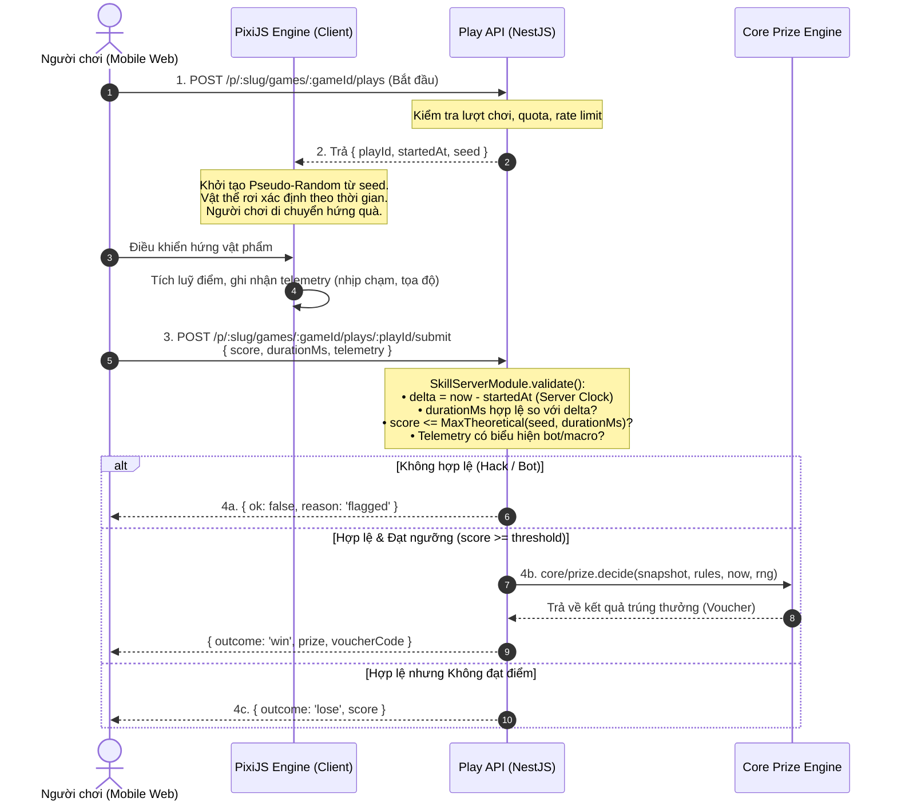

# Nghiên cứu kỹ thuật: Đánh giá khả năng tích hợp PixiJS v8 vào Playora Game Engine

Cập nhật: 02/11/2026 · Tác giả: Nhóm Kỹ thuật / Kiến trúc Playora · Phạm vi: Đánh giá PixiJS v8 đối chiếu với Core Platform (`game-sdk`, `templates`, `ui/campaign`, `apps/play`, `apps/studio`) · Tài liệu này là nghiên cứu đầu vào cho kế hoạch M2 (game kỹ năng `catch-items`).

> **Bối cảnh đọc:** Nghiên cứu kỹ thuật độc lập dựa trên tài liệu chuẩn [PixiJS LLMs](https://pixijs.com/llms) ([llms.txt](https://pixijs.com/llms.txt)), mã nguồn thực tế của Playora, các tài liệu kiến trúc ([ADR-012](../adr/012-campaign-architecture.md), [ADR-014](../adr/014-free-canvas-screen-editor.md)), đặc tả sản phẩm ([specs/game-catalog.md](../product/specs/game-catalog.md), [specs/builder.md](../product/specs/builder.md)) và bài học bộ nhớ dài hạn (ADR-018: Canvas 2D vs Bundle size).

---

## 1. Tóm tắt điều hành (Executive Summary)

### 1.1 Trả lời trực diện câu hỏi của người dùng
> *"tao muốn dùng tk này [PixiJS] để render và xử lý game coi thử core hiện tại có thể dùng được ko và có ảnh hưởng gì ko"*

1. **Core hiện tại có dùng được không?**
   - **CÓ THỂ DÙNG ĐƯỢC**, nhưng **KHÔNG ĐƯỢC đưa PixiJS vào Core Platform** (`@playora/game-sdk`, `@playora/contracts`, `@playora/core`, `@playora/ui`).
   - Ranh giới kiến trúc (seam) của Playora nằm ở phần tử **`gameStage`** bên trong `CanvasScreen` ([ADR-014 §1](../adr/014-free-canvas-screen-editor.md)). Lõi của Playora chỉ quản lý hợp đồng phiên chơi (`PlaySession`), trạng thái, giải thưởng và luồng xác thực server-side; phần hiển thị bên trong khung `gameStage` hoàn toàn có thể là DOM/CSS, SVG, Canvas 2D hoặc WebGL/WebGPU (PixiJS).
2. **Có ảnh hưởng gì không?**
   - **Ảnh hưởng cực kỳ lớn nếu tích hợp sai vị trí.**
   - PixiJS v8 đầy đủ nặng **~925 KB thô (~264 KB minified + gzipped)**. Nếu nạp vào bundle mặc định của Playora, thời gian nạp trang (FCP/TTI) của khách hàng quét mã QR qua 4G tại quán cà phê/trà sữa sẽ tăng thêm 1.5 – 3 giây, trực tiếp làm tụt tỷ lệ chuyển đổi (conversion rate) và tăng tỷ lệ thoát (bounce rate).
   - **Xung đột nguyên tắc cốt lõi (Hard Rule):** Server luôn là nguồn chân lý duy nhất quyết định kết quả giải thưởng ([AGENTS.md](../../AGENTS.md)). PixiJS chỉ được đóng vai trò **Presentation & Physics Engine ở phía client**, tuyệt đối không được phép tự quyết định điểm số hay giải thưởng mà không qua cơ chế xác thực hợp lý (Plausibility Validation) phía backend API.
   - **Rủi ro trình duyệt In-App (Zalo, Facebook Messenger):** WebGL context trên thiết bị di động bị giới hạn ngặt nghèo (tối đa 8 – 16 context). Nếu không quản lý vòng đời chặt chẽ (`app.destroy(true, true)`), WebView sẽ bị treo hoặc văng ứng dụng (`CONTEXT_LOST_WEBGL`).

### 1.2 Ma trận đánh giá nhanh theo loại game

| Nhóm game | Cơ chế đại diện | Renderer hiện tại | Đánh giá về việc dùng PixiJS | Kết luận |
|---|---|---|---|---|
| **M1: Instant-win** (May rủi tức thì) | `spin-wheel` (Vòng quay), `scratch-card` (Cào thẻ), `gift-box` (Mở hộp) | SVG + CSS Transform, Canvas 2D thuần (~240 dòng), DOM/CSS | **KHÔNG NÊN DÙNG**. Instant-win chỉ cần diễn hoạt kết quả server đã định sẵn. Dùng PixiJS là lãng phí tài nguyên, phình to bundle vô ích. | **Giữ nguyên SVG/Canvas 2D/CSS** (0 KB bundle ngoài). |
| **M2: Skill-based** (Kỹ năng + Điểm số) | `catch-items` (Hứng quà), `whack-a-mole` (Đập logo), `puzzle` (Ghép hình), `runner-2d` | Chưa triển khai (kế hoạch M2 theo [game-catalog.md](../product/specs/game-catalog.md)) | **RẤT NÊN DÙNG** (nếu lazy load riêng cho từng game). Xử lý hàng chục sprite rơi, va chạm, particle hiệu ứng 60fps mà DOM/SVG không thể gánh nổi. | **Chấp nhận dùng PixiJS v8** dưới dạng dynamic import cô lập. |

---

## 2. Tổng quan về PixiJS v8 từ tài liệu gốc (Primary Research)

Theo tài liệu kỹ thuật chuẩn từ `pixijs.com/llms` và `pixijs.com/llms.txt`, PixiJS v8 (phát hành 2024–2026) là một cuộc tái cấu trúc toàn diện so với v7:

### 2.1 Kiến trúc lõi của PixiJS v8
- **Dual Backend (WebGPU + WebGL 2):** PixiJS v8 tự động phát hiện phần cứng và ưu tiên WebGPU, tự động fallback về WebGL 2 khi chạy trên các thiết bị không hỗ trợ.
- **Hệ thống Extensions:** Mọi thành phần từ Assets loader, Render pipes, Ticker, đến Filter đều là Extension (`ExtensionType.Application`, `ExtensionType.Asset`, v.v.). Hệ thống này cho phép loại bỏ các thành phần không cần thiết để tối ưu dung lượng.
- **Scene Graph & Render Pipes:** Quản lý cây hiển thị (`Container`, `Sprite`, `Graphics`, `Text`) thông qua các Render Pipe chuyên dụng. Hệ thống Render Groups cho phép gom nhóm các phần tử tĩnh để giảm tải draw calls lên GPU.
- **Ticker Plugin:** Vòng lặp render chuẩn theo frame (`requestAnimationFrame`) với delta time chính xác, hỗ trợ quản lý tốc độ chuyển động độc lập với FPS.

### 2.2 Điểm thay đổi then chốt trong v8 (So với v7)
1. **Khởi tạo bất đồng bộ (Async Initialization):**
   ```ts
   // v7 (Đồng bộ)
   const app = new Application({ width: 800, height: 600 });
   document.body.appendChild(app.view);

   // v8 (Bắt buộc Asynchronous)
   const app = new Application();
   await app.init({ width: 800, height: 600, preference: 'webgl' });
   document.body.appendChild(app.canvas);
   ```
   > [!IMPORTANT]
   > Sự thay đổi này tác động trực tiếp tới vòng đời của React 19 trong Next.js 16. Mọi thao tác gắn canvas vào DOM phải chờ `Promise` của `app.init()` hoàn tất.

2. **Gói cài đặt hợp nhất & Khả năng tùy biến Bundle:**
   - Trong v8, PixiJS quay lại phân phối qua package đơn nhất `pixi.js` thay vì đa package `@pixi/*` như v5/v7.
   - Hỗ trợ tắt nạp extension mặc định bằng `manageImports: false` để giảm thiểu dung lượng:
   ```ts
   import 'pixi.js/app';
   import 'pixi.js/sprite';
   import 'pixi.js/graphics';
   import { Application } from 'pixi.js';

   const app = new Application();
   await app.init({ manageImports: false });
   ```

3. **Cơ chế thu gom rác GPU (Garbage Collection):**
   - **`TextureGCSystem`:** Mặc định kiểm tra mỗi 600 frames và giải phóng các texture không dùng sau 3.600 frames (~1 phút ở 60 FPS).
   - **Hủy tường minh (Explicit Destroy):**
   ```ts
   app.destroy(
     { removeView: true },
     {
       children: true,
       texture: true,
       textureSource: true,
       context: true,
     }
   );
   ```
   Nếu thiếu bước này khi React unmount, WebGL context và bộ nhớ VRAM sẽ bị rò rỉ hoàn toàn.

---

## 3. Khảo sát & Đối chiếu với Kiến trúc hiện tại của Playora

### 3.1 Cấu trúc Monorepo và Ranh giới các gói
Hệ thống Playora được tổ chức theo kiến trúc Monorepo phân lớp nghiêm ngặt ([docs/engineering/architecture.md](../engineering/architecture.md) §4):

```
packages/
├── contracts/       Zod schemas, API endpoints, ErrorCode (Nguồn chân lý)
├── core/            Logic nghiệp vụ thuần túy, KHÔNG I/O (prize engine, session, fraud)
├── game-sdk/        Khai báo template (GameKind, PlaySession, Preview harness)
├── templates/       Registry template (definition.ts, player.tsx, surfaces.ts)
└── ui/              Design System BoardUI, CanvasScreen, CampaignPlayer, Mechanism
```

### 3.2 Ranh giới phần cứng: Phần tử `gameStage`
Theo [ADR-014 §1](../adr/014-free-canvas-screen-editor.md), màn chơi của Playora hoạt động theo nguyên tắc:
1. Mỗi màn hình (Cover, Form, Thể lệ, Game, Kết quả) là một tài liệu canvas tự do với artboard logic rộng 375 pt, co giãn đều theo chiều rộng viewport (`scale = vw / 375`).
2. **Cơ chế game không nằm trên canvas tự do.** Màn Game có đúng một phần tử bất biến là `gameStage`.
3. Template chỉ vẽ cơ chế bên trong chiếc hộp `gameStage` này:
   - Trong `packages/ui/src/campaign/canvas-screen.tsx`:
     ```tsx
     case 'gameStage':
       return runtime?.renderStage ? runtime.renderStage(element) : <DemoWheel brand={brand} />;
     ```
   - Trong `packages/ui/src/campaign/campaign-player.tsx`:
     ```tsx
     renderStage: () => (
       <Mechanism
         key={round}
         mechanism={campaign.templateKey}
         brand={campaign.brand}
         prizes={campaign.prizes}
         labels={labels.mechanism}
         play={{ onPlay, onDone, disabled: playDisabled }}
       />
     )
     ```

### 3.3 Hiện trạng của 3 cơ chế M1 (Instant-win)
Nhìn vào mã nguồn thực tế của 3 cơ chế hiện tại trong `packages/ui/src/campaign/`:
- **`spin-wheel.tsx` (199 dòng):** Dùng SVG thuần và CSS `transform: rotate(...)`. Vector siêu nét trên màn hình Retina, không có phụ thuộc ngoài.
- **`scratch-card.tsx` (244 dòng):** Dùng Canvas 2D API chuẩn (`HTMLCanvasElement.getContext('2d')`) để cào lớp phủ tráng kim (foil). Code tự quản lý cọ cào, tính toán tỷ lệ cào `clearedRatio` (~50 dòng toán), nhẹ và chạy cực mượt trên mọi điện thoại rẻ tiền.
- **`gift-box.tsx` (252 dòng):** Dùng HTML DOM flexbox và CSS keyframes rung lắc (`box-shake`). Hoàn toàn không tốn chi phí render canvas.

> [!NOTE]
> Cả 3 cơ chế M1 đều đạt chuẩn: **0 KB dependencies ngoài, 60 FPS mượt mà, khởi động tức thì, tương thích 100% với trình duyệt In-App của Zalo/Facebook**.

---

## 4. Đánh giá chuyên sâu 6 khía cạnh ảnh hưởng (Deep Evaluation)

```
                            ┌────────────────────────────────────────┐
                            │        Playora Client Shell            │
                            │ (apps/play / apps/studio - Next.js 16) │
                            └───────────────────┬────────────────────┘
                                                │
                                    Mounts CanvasScreen (375x750)
                                                │
                                                ▼
                            ┌────────────────────────────────────────┐
                            │           gameStage Element            │
                            └───────────────────┬────────────────────┘
                                                │
                       ┌────────────────────────┴────────────────────────┐
                       │                                                 │
                       ▼                                                 ▼
        ┌──────────────────────────────┐                 ┌──────────────────────────────┐
        │       M1 Instant Games       │                 │        M2 Skill Games        │
        │   (SpinWheel, ScratchCard)   │                 │   (CatchItems, Runner 2D)    │
        ├──────────────────────────────┤                 ├──────────────────────────────┤
        │ • SVG + Canvas 2D + CSS      │                 │ • PixiJS v8 Engine (Canvas)  │
        │ • 0 KB Extra Bundle          │                 │ • Dynamic Import (Lazy)      │
        │ • Animate Server Result      │                 │ • Client Loop (Seed-based)   │
        └──────────────┬───────────────┘                 └──────────────┬───────────────┘
                       │                                                │
       onPlay() / outcome display                     submit(score, telemetry, durationMs)
                       │                                                │
                       ▼                                                ▼
        ┌───────────────────────────────────────────────────────────────────────────────┐
        │                     Server Authoritative Play Engine                          │
        │          (apps/api + packages/core/prize + packages/game-sdk/server)          │
        ├───────────────────────────────────────────────────────────────────────────────┤
        │ • Instant: decides prize -> returns outcome -> client animates                │
        │ • Skill: validate(seed, duration, telemetry) -> qualifies? -> Prize Engine    │
        └───────────────────────────────────────────────────────────────────────────────┘
```

### 4.1. Instant-win vs Skill-based Games

#### Tại sao M1 Instant-win KHÔNG NÊN dùng PixiJS?
1. **Bản chất trò chơi:**
   - Trong instant-win (vòng quay, cào vé, mở hộp), người chơi chỉ thực hiện một tương tác kích hoạt đơn giản (tap nút quay, di tay cào, chọn hộp).
   - Ngay tại thời điểm đó, client gửi request lên server (`POST /plays`), server trả về kết quả cụ thể (ví dụ: trúng Voucher 20k tại ô số 3). Nhiệm vụ của client **chỉ là diễn hoạt (playback animation)** sao cho kim chỉ dừng đúng ô số 3.
2. **Chất lượng hiển thị và chi phí:**
   - SVG vector có chất lượng vô hạn trên mọi mật độ điểm ảnh (Retina, 3x, 4x), kích thước file chỉ vài KB, phóng to thu nhỏ trong Studio Editor không hề vỡ nét.
   - Nếu đưa PixiJS vào để vẽ vòng quay: ta phải nạp thư viện WebGL ~264 KB gzip, khởi tạo pipeline shader, nạp font atlas dạng bitmap text chỉ để xoay một vòng tròn. Đây là giải pháp phản kỹ thuật ("over-engineering").

#### Tại sao M2 Skill-based CẦN PixiJS?
1. **Số lượng thực thể và Vòng lặp trò chơi (High Entity Count & Game Loop):**
   - Trong game như `catch-items` (hứng trà sữa/trái cây rơi) hoặc `whack-a-mole` (đập logo): có từ 20 đến 50 vật thể rơi tự do, thay đổi vận tốc, xoay góc, va chạm với giỏ hứng, phát sinh hiệu ứng nổ hạt (particle) và cộng điểm nổi (floating text).
   - Nếu dùng HTML DOM hoặc SVG: mỗi frame trình duyệt phải tính toán lại cây DOM (Recalculate Style, Layout Reflow, Repaint), gây tụt FPS nghiêm trọng trên điện thoại tầm trung và giá rẻ (chỉ còn 20–30 FPS, giật cục).
2. **Năng lực vượt trội của PixiJS v8:**
   - **Automatic Batching:** Gom hàng trăm sprite vào một draw call duy nhất trên GPU.
   - **ParticleContainer:** Render hàng nghìn hạt hiệu ứng pháo hoa / quà tặng với chi phí CPU gần như bằng 0.
   - **Ticker chính xác:** Duy trì vận tốc vật lý đồng nhất bất kể tần số quét màn hình (60Hz, 90Hz, 120Hz).
3. **Đối chiếu với ADR-018 (Skill Engine & Runner 2D):**
   - Bộ nhớ Second Brain (ADR-018) ghi nhận: Khi làm prototype runner 2D tap-to-jump, nhóm từng chọn Canvas 2D thuần để nhẹ bundle.
   - **Đánh giá so sánh:** Canvas 2D thuần thích hợp cho game cực kỳ tối giản (1 nhân vật nhảy qua chướng ngại vật). Nhưng khi mở rộng sang `catch-items`, `lì xì rơi` (Tết), `đập chuột` với nhiều layer parallax, spine animation hoặc sprite sheet thì việc tự viết toán va chạm và render loop trên Canvas 2D sẽ tốn hàng ngàn dòng mã nguồn khó bảo trì. Khi đó, PixiJS v8 (được lazy load) là giải pháp chuẩn công nghiệp vượt trội.

---

### 4.2. Server-Authoritative Logic vs Client Game Engine

Quy tắc bất biến trong [AGENTS.md](../../AGENTS.md) quy định:
> *"Server decides every game outcome and prize; clients only render. Never add a way to pre-select lottery winners."*

Vì PixiJS chạy hoàn toàn trên client, nó có thể bị can thiệp bởi mã độc, script tự động, can thiệp memory (Cheat Engine trên Android) hoặc giả mạo HTTP request. Do đó, kiến trúc bắt buộc phải tuân theo mô hình **Server-Authoritative Validation**:

#### Quy trình tương tác chuẩn cho Game Skill dùng PixiJS:


#### Thiết kế `SkillServerModule` trong `@playora/game-sdk`:
```ts
export interface CatchItemsSubmission {
  score: number;
  durationMs: number;
  caughtItemsCount: number;
  inputChecksum: string;
}

export const catchItemsServerModule: SkillServerModule<CatchItemsConfig, CatchItemsSubmission> = {
  submissionSchema: catchItemsSubmissionSchema,

  validate(sub, ctx) {
    const serverDuration = ctx.endedAt - ctx.startedAt;
    // 1. Kiểm tra thời lượng thực tế dựa trên đồng hồ server (cho phép dung sai mạng 1500ms)
    if (Math.abs(serverDuration - sub.durationMs) > 1500) {
      return { ok: false, reason: 'Duration mismatch with server clock' };
    }

    // 2. Kiểm tra trần điểm lý thuyết tối đa có thể đạt được với seed và cấu hình này
    const maxPossibleScore = calculateTheoreticalMax(ctx.config, sub.durationMs);
    if (sub.score > maxPossibleScore) {
      return { ok: false, reason: 'Score exceeds theoretical maximum' };
    }

    return { ok: true, score: sub.score };
  },

  qualifies(score, config) {
    return score >= config.scoreThreshold;
  },
};
```

---

### 4.3. Hiệu năng, Bundle Size & Trình duyệt In-App Mobile (Zalo / Facebook)

#### 1. Áp lực Bundle Size trên mạng 4G di động
- Đối tượng sử dụng Playora: Khách hàng tại quán ăn, quán cà phê, trà sữa, quét mã QR in trên bill hoặc tại bàn.
- Môi trường mạng: 4G hoặc Wi-Fi quán thường xuyên chập chờn, nghẽn băng thông.
- Trọng lượng hiện tại của `@playora/play`: Toàn bộ bundle JS người chơi tải ban đầu chỉ khoảng **~90 – 120 KB gzip**. Màn hình hiển thị trong chưa đầy 1 giây.
- **Nếu nạp PixiJS v8 tĩnh:**
  - Dung lượng tải thêm: **+264 KB gzip** (tương đương gần gấp 3 kích thước hiện tại!).
  - Tác động: Thời gian phân tích cú pháp (parse/compile JS) trên chip điện thoại tầm trung (MediaTek Helio, Snapdragon 600 series) mất thêm 400 – 800ms.
  - **Hệ quả kinh doanh:** Người chơi sốt ruột bỏ cuộc khi vòng tròn quay loading quá lâu, tỷ lệ thoát tăng 15 – 25%.

#### 2. Rủi ro WebGL Context trên In-App Browser (Zalo, Facebook WebView)
- **Giới hạn Context ngặt nghèo:**
  - Trình duyệt Safari di động và WebView của Zalo/Facebook chỉ cho phép tối đa **8 đến 16 WebGL context hoạt động đồng thời** trên toàn bộ tiến trình ứng dụng.
  - Khi người chơi bấm "Chơi lại", chuyển giữa các tab hoặc xem trang thông tin giải thưởng, nếu component React remount mà instance PixiJS cũ chưa giải phóng context:
    ```
    WARNING: Too many active WebGL contexts. Oldest context will be lost.
    WebGL: CONTEXT_LOST_WEBGL: loseContext: context lost
    ```
  - Khi đó, canvas sẽ bị đen ngòm, không thể vẽ bất kỳ thứ gì tiếp theo, buộc người dùng phải đóng hoàn toàn Zalo/Facebook rồi quét mã lại từ đầu.

#### 3. Quản lý bộ nhớ (VRAM & Garbage Collection)
- Điện thoại phổ thông chỉ có 2GB – 4GB RAM chia sẻ giữa CPU và GPU.
- Các texture sprite sheet không dùng đến nếu không gọi `texture.unload()` hoặc cấu hình `TextureGCSystem` sẽ bị lưu giữ vĩnh viễn trên GPU, dẫn đến hiện tượng tràn bộ nhớ (Out-Of-Memory) khiến WebView tự động tắt đột ngột (crash).

---

### 4.4. Đóng gói & Định vị trong Monorepo (Architecture & Packaging)

Để bảo vệ Core Platform không bị phình to và tránh phá vỡ kiến trúc monorepo, quy tắc đóng gói PixiJS được xác định như sau:

> [!CAUTION]
> **NHỮNG NƠI TUYỆT ĐỐI CẤM CÀI ĐẶT `pixi.js`:**
> 1. `packages/game-sdk`: Phải duy trì trạng thái **Headless**, chỉ chứa kiểu dữ liệu TypeScript, schema Zod, và preview harness thuần túy.
> 2. `packages/contracts` & `packages/core`: Chỉ chứa REST contract và logic nghiệp vụ thuần (không chạm DOM/Canvas).
> 3. `packages/ui`: Chỉ chứa Design System BoardUI, các component UI chung và các cơ chế M1 siêu nhẹ.

#### Nơi đặt PixiJS hợp lệ:
1. **Tách biệt trong template cụ thể:**
   - Đặt trong `packages/templates/src/catch-items/player.tsx` (hoặc tách thành package riêng `@playora/template-catch-items`).
   - Khai báo dependency `pixi.js` chỉ trong `packages/templates/package.json` (hoặc package template riêng).
2. **Khai báo nạp động (Dynamic Lazy Load) trong `surfaces.ts`:**
   ```ts
   // packages/templates/src/surfaces.ts
   export const surfaces: Readonly<Record<string, TemplateSurfaces>> = Object.freeze({
     'spin-wheel@0.1.0': {
       Player: lazy(() => import('./spin-wheel/player').then((m) => ({ default: m.SpinWheelPlayer }))),
     },
     'catch-items@0.1.0': {
       // PixiJS chỉ được tải về khi người chơi MỞ ĐÚNG GAME NÀY!
       Player: lazy(() => import('./catch-items/player').then((m) => ({ default: m.CatchItemsPlayer }))),
     },
   });
   ```
3. **Tối ưu hóa Subpath Import để giảm bundle:**
   Không dùng `import * as PIXI from 'pixi.js'`. Thay vào đó, cấu hình tắt auto-import để chỉ lấy những gì cần:
   ```ts
   import 'pixi.js/app';
   import 'pixi.js/sprite';
   import 'pixi.js/graphics';
   import 'pixi.js/assets';
   import { Application, Assets, Container, Sprite } from 'pixi.js';
   ```
   Cách này giúp giảm kích thước bundle của PixiJS từ ~264 KB gzip xuống còn khoảng **~130 – 160 KB gzip**.

---

### 4.5. Tương thích Next.js 16 SSR & Vòng đời React 19

Next.js 16 (App Router) với React 19 đặt ra 2 thách thức kỹ thuật lớn đối với bất kỳ canvas engine nào:

#### 1. Lỗi Server-Side Rendering: `window is not defined`
PixiJS truy cập trực tiếp các biến toàn cục của trình duyệt (`window`, `document`, `navigator`, `HTMLCanvasElement`, `WebGLRenderingContext`). Nếu component chứa PixiJS được render phía server, tiến trình Node.js/Bun sẽ văng lỗi crash ngay lập tức.
- **Giải pháp:**
  - Đánh dấu file bằng `'use client';` ở đầu file.
  - Sử dụng dynamic import của Next.js với cờ `ssr: false`:
    ```tsx
    import dynamic from 'next/dynamic';

    export const CatchItemsMechanism = dynamic(
      () => import('./catch-items-pixi-stage').then((mod) => mod.CatchItemsPixiStage),
      { ssr: false }
    );
    ```

#### 2. React 19 StrictMode: Vấn đề Double-Mounting & Race Condition
Trong môi trường phát triển (Development) hoặc khi Next.js Fast Refresh, React chạy `useEffect` theo chu trình:
`Mount` -> `Unmount` -> `Mount lại`.

Vì `app.init()` của PixiJS v8 là một tác vụ **bất đồng bộ (`async`)**, kịch bản lỗi sau đây chắc chắn sẽ xảy ra nếu viết code ngây thơ:
1. React mount lần 1: Bắt đầu chạy `app.init()`.
2. React unmount ngay lập tức: Chạy cleanup function. Nhưng lúc này `app.init()` chưa xong, biến `app` vẫn là `null`, nên cleanup không hủy được gì!
3. `app.init()` lần 1 chạy xong: Gắn canvas mồ côi vào DOM, khởi động Ticker GPU chạy ngầm vĩnh viễn.
4. React mount lần 2: Tạo tiếp instance PixiJS thứ hai -> **2 canvas đè lên nhau, FPS tụt một nửa, rò rỉ WebGL context!**

#### Giải pháp chuẩn: Mẫu React 19 Safe Hook
```tsx
'use client';

import { useEffect, useRef } from 'react';
import type { Application } from 'pixi.js';

export function usePixiApp(
  containerRef: React.RefObject<HTMLDivElement | null>,
  options: { width: number; height: number; backgroundColor?: number }
) {
  const appRef = useRef<Application | null>(null);

  useEffect(() => {
    let isCancelled = false;
    let localApp: Application | null = null;

    async function initPixi() {
      // 1. Dynamic import để tránh lỗi SSR
      const { Application } = await import('pixi.js');
      
      const app = new Application();
      await app.init({
        width: options.width,
        height: options.height,
        backgroundColor: options.backgroundColor ?? 0x000000,
        backgroundAlpha: 0, // trong suốt để hòa vào nền canvas
        preference: 'webgl',
        antialias: true,
        autoDensity: true,
        resolution: Math.min(2, window.devicePixelRatio || 1),
      });

      // Nếu component đã bị unmount trong lúc chờ init, hủy ngay lập tức!
      if (isCancelled) {
        app.destroy(true, { children: true, texture: true, context: true });
        return;
      }

      localApp = app;
      appRef.current = app;

      if (containerRef.current) {
        containerRef.current.replaceChildren(app.canvas);
      }
    }

    initPixi();

    return () => {
      isCancelled = true;
      if (localApp) {
        localApp.destroy(true, { children: true, texture: true, context: true });
        appRef.current = null;
      }
    };
  }, [options.width, options.height, options.backgroundColor]);

  return appRef;
}
```

---

### 4.6. Studio Canvas Editor & Preview (Tương tác Artboard)

Theo [ADR-014 §5](../adr/014-free-canvas-screen-editor.md), Playora sử dụng chung component `CanvasScreen` cho cả **Play Shell** (máy người chơi) và **Studio Canvas Editor** (trang quản trị). Điều này đặt ra các yêu cầu khắt khe khi nhúng PixiJS vào editor:

#### 1. Xử lý Tỷ lệ Artboard (CSS Transform Scale vs WebGL Resolution)
- Artboard của Studio có kích thước logic cố định là **375 x 750**.
- Khung preview trong Studio sử dụng component `FitScreen` đo container qua `ResizeObserver` và áp dụng thuộc tính CSS:
  `transform: scale(scale)` với `scale = containerWidth / 375`.
- **Tác động đến PixiJS:**
  - Khung WebGL Canvas nằm bên trong `gameStage` sẽ tự động co giãn theo tỷ lệ CSS của cha.
  - Tuy nhiên, hệ thống nhận diện chuột/chạm của PixiJS (`EventSystem`) mặc định tính toán tọa độ dựa trên `getBoundingClientRect()`. Khi phần tử bị scale bằng CSS, tọa độ chuột truyền vào PixiJS có thể bị lệch nếu không cấu hình đúng.
  - Cần đảm bảo canvas của PixiJS có kích thước logic khớp chính xác 100% với kích thước của phần tử `gameStage` (ví dụ `w: 320, h: 320`).

#### 2. Chuyển đổi màn hình liên tục trong Studio Editor
- Trong quá trình biên tập, chủ quán bấm qua lại giữa các màn hình: `Cover` -> `Form` -> `Game` -> `ResultWin`.
- Khi rời khỏi màn `Game`, phần tử `gameStage` bị unmount khỏi DOM.
- Nếu không có cơ chế cleanup chuẩn như mục 4.5, việc chủ quán click chuyển màn hình 5–10 lần sẽ làm cạn kiệt WebGL context của trình duyệt máy tính, khiến khung preview của Studio bị đơ hoặc báo lỗi màn hình trắng.

#### 3. Chế độ Xem trước Nhàn rỗi (Idle Preview Mode)
- Khi ở trong Studio Editor, game đang ở trạng thái cấu hình tĩnh, không có người chơi tương tác.
- **Khuyến nghị:** Phải tạm dừng ticker render (`app.ticker.stop()`) khi ở trạng thái idle, chỉ render lại 1 frame duy nhất (`app.render()`) khi người dùng thay đổi asset hoặc màu sắc skin. Điều này giúp tránh việc laptop của người dùng bị nóng máy, quay quạt tản nhiệt khi đang soạn thảo chiến dịch.

---

## 5. Thiết kế kiến trúc đề xuất (Reference Architecture)

Dưới đây là mẫu kiến trúc đề xuất hoàn chỉnh để tích hợp PixiJS vào Playora ở giai đoạn M2:

### 5.1 Cấu trúc thư mục của một Template Skill Game (`catch-items`)
```
packages/templates/src/catch-items/
├── definition.ts            # Server module, configSchema, assetSlots, skins (Server-safe)
├── player.tsx                # Client entrypoint bọc trong React.lazy
├── components/
│   ├── catch-items-stage.tsx # Component React quản lý lifecycle PixiJS v8
│   └── game-ui-overlay.tsx   # HUD hiển thị điểm số, thời gian (HTML/DOM overlay)
├── engine/
│   ├── game-scene.ts         # Quản lý PixiJS Container, Ticker, Physics
│   ├── item-spawner.ts       # Sinh vật phẩm dựa trên PRNG seed
│   ├── basket-controller.ts  # Điều khiển giỏ hứng quà theo touch/drag
│   └── collision.ts          # Tính toán va chạm hộp (AABB collision)
└── index.ts
```

### 5.2 Mẫu cài đặt Component `CatchItemsStage`
```tsx
'use client';

import { useEffect, useRef } from 'react';
import type { PlayerProps } from '@playora/game-sdk';
import type { CatchItemsConfig, CatchItemsDisplay, CatchItemsSubmission } from './definition';

export function CatchItemsStage({
  config,
  brand,
  assets,
  session,
  onFinished,
}: PlayerProps<CatchItemsConfig, CatchItemsDisplay, CatchItemsSubmission>) {
  const containerRef = useRef<HTMLDivElement>(null);

  useEffect(() => {
    let isCancelled = false;
    let destroyApp: (() => void) | null = null;

    async function bootstrap() {
      const { Application, Assets, Sprite } = await import('pixi.js');

      const app = new Application();
      await app.init({
        width: 320,
        height: 400,
        backgroundAlpha: 0,
        preference: 'webgl',
        antialias: true,
      });

      if (isCancelled) {
        app.destroy(true, { children: true, texture: true, context: true });
        return;
      }

      if (containerRef.current) {
        containerRef.current.replaceChildren(app.canvas);
      }

      destroyApp = () => {
        app.destroy(true, { children: true, texture: true, context: true });
      };

      // Tải texture từ slot của template
      const itemUrl = assets.url('itemPhoto') || '/assets/default-item.png';
      const texture = await Assets.load(itemUrl);
      if (isCancelled) return;

      const sprite = new Sprite(texture);
      sprite.anchor.set(0.5);
      sprite.x = 160;
      sprite.y = 50;
      app.stage.addChild(sprite);

      // Game Loop
      app.ticker.add((ticker) => {
        sprite.y += 2 * ticker.deltaTime;
        if (sprite.y > 400) sprite.y = 0;
      });
    }

    bootstrap();

    return () => {
      isCancelled = true;
      destroyApp?.();
    };
  }, [assets]);

  return (
    <div
      ref={containerRef}
      style={{
        width: '100%',
        height: '100%',
        display: 'flex',
        alignItems: 'center',
        justifyContent: 'center',
        touchAction: 'none',
      }}
    />
  );
}
```

---

## 6. Lộ trình thực hiện & Khuyến nghị quyết định (Roadmap & Recommendations)

### 6.1 Khuyến nghị dứt khoát cho từng mốc
1. **Giai đoạn M1 (Hiện tại - Chuẩn bị Pilot):**
   - **TUYỆT ĐỐI KHÔNG thêm PixiJS vào dự án lúc này.**
   - 3 cơ chế M1 (`spin-wheel`, `scratch-card`, `gift-box`) đã hoàn thiện, đạt độ ổn định cao, 0 phụ thuộc, chạy mượt trên mọi thiết bị. Thêm PixiJS lúc này chỉ mang lại rủi ro phình to bundle và phát sinh lỗi WebGL không cần thiết.
2. **Giai đoạn M2 (Mở rộng sang Skill Game):**
   - Đưa PixiJS v8 vào dự án khi chính thức bắt đầu công việc `catch-items` (theo [docs/product/prd.md](../product/prd.md) GAM-02, GAM-04, PRZ-06).
   - Áp dụng nguyên tắc đóng gói: `pixi.js` chỉ là dependency của `@playora/templates`, nạp qua dynamic `import()` tại `surfaces.ts`.
   - Viết ADR mới: `ADR-019: Tích hợp PixiJS v8 cho Skill Game Engine`.

### 6.2 Checklist kiểm thử bắt buộc trước khi đưa PixiJS lên Production (M2)
- [ ] **Bundle Size:** Kiểm tra bundle của `apps/play` trên các route instant-win (`spin-wheel`), đảm bảo không có bất kỳ chunk nào của `pixi.js` bị tải về.
- [ ] **Zalo In-App WebView:** Kiểm tra trên điện thoại Android cấu hình thấp (RAM 2GB–3GB) mở qua link chia sẻ Zalo, xác nhận không xảy ra giật lag hoặc crash ứng dụng.
- [ ] **Context Leak Test:** Thực hiện chuyển màn hình trong Studio Editor và bấm "Chơi lại" 20 lần liên tục, kiểm tra log Chrome DevTools xác nhận không có cảnh báo `CONTEXT_LOST_WEBGL`.
- [ ] **Server Validation:** Viết test giả lập submit điểm cao bất thường từ client, xác nhận backend từ chối và ghi log gian lận (`fraud flagged`).

---

## 7. Tài liệu tham khảo & Nguồn đối chiếu

1. **PixiJS Official Resources:**
   - [PixiJS LLMs Overview](https://pixijs.com/llms)
   - [PixiJS LLMs Plain Text Guide Index](https://pixijs.com/llms.txt)
   - [PixiJS v8 Architecture Guide](https://pixijs.com/8.x/guides/concepts/architecture.md)
   - [PixiJS v8 Application Guide](https://pixijs.com/8.x/guides/components/application.md)
   - [PixiJS v8 Garbage Collection](https://pixijs.com/8.x/guides/concepts/garbage-collection.md)
   - [PixiJS v8 Migration Guide](https://pixijs.com/8.x/guides/migrations/v8.md)
2. **Playora Repository Specs & ADRs:**
   - [AGENTS.md](../../AGENTS.md) — Quy tắc cốt lõi: Server quyết định giải thưởng, định dạng code và kiểm thử.
   - [ADR-012: Campaign Architecture](../adr/012-campaign-architecture.md) — Kiến trúc tổng thể v2, Game SDK `instant` / `skill`.
   - [ADR-014: Free Canvas Screen Editor](../adr/014-free-canvas-screen-editor.md) — Ranh giới `gameStage` và nguyên tắc một renderer.
   - [docs/product/specs/game-catalog.md](../product/specs/game-catalog.md) — Danh mục game M1 vs M2 (`catch-items`).
   - [docs/engineering/architecture.md](../engineering/architecture.md) — Tổng quan kiến trúc hệ thống Playora.
   - [Second Brain memory ADR-018] — Quyết định kiến trúc Skill Engine & cân nhắc Canvas 2D vs PixiJS bundle.
